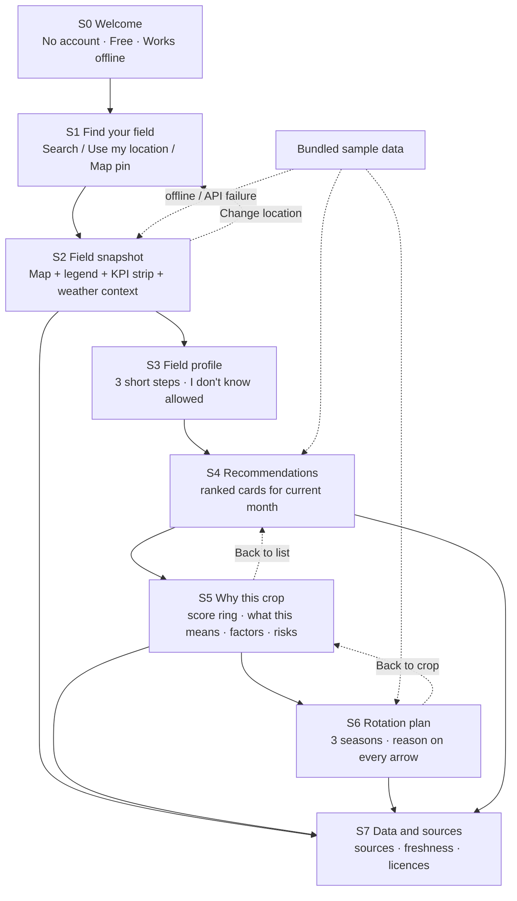

# Serumpun — Product Requirements Document (PRD)

> **Post-release amendment (2026-11-14):** at the product owner's request, the global
> *Live / Partly estimated / Offline sample* status banner was removed from the web app.
> US-09, R-10 and the "Global" UI rules below describe the original 1.0.0 design; the
> shipped web build surfaces provenance per value (`SourceLabel`, `EstimatedBadge`) and on
> the Data & sources screen instead. All other offline-behaviour requirements are unchanged.

| Field | Value |
|---|---|
| Document | `01-prd.md` — Simple PRD (no competitor / market analysis requested) |
| Author | Xu (许清楚), Product Manager |
| Date | 2026-11-13 |
| Status | Ready for architecture (Gao) and implementation (Kou) |
| Language | English (user wrote in English). Bahasa Indonesia labels are an optional P1 touch. |
| Project name | `serumpun` |
| Programming language / stack | Vite + React + TypeScript, responsive mobile-first web app, PWA-ready (per research brief §5). Component/styling choice (MUI + Tailwind CSS by default) is the Architect's call — this PRD does not mandate it. Optional Electron wrapper lives in a separate `desktop/` folder with its own `package.json`. |
| Source of truth | `docs/00-research-brief.md` (verified API endpoints, licences, Mobbin references, non-negotiable constraints). This PRD does not contradict it. |

## 0. Original requirement (restated)

Build software named **Serumpun** using the NASA Space Apps 2026 challenge *"Field Shift: Adapting Farms with NASA Data"* resources plus other free NASA / open data APIs. It recommends **what crop to plant at a given location AND at that time of year**, factoring in soil type, environment, surroundings, weather, and related agro-climatic conditions. It also suggests **what crop to plant next using crop rotation**. Target users are **smallholder / small-stakeholder farmers**. It can access the internet. It must be **completely free — no API keys, no accounts, no payment, no trials, no vendor lock-in, no ads, no tracking**. Use Mobbin for UI/UX inspiration. Platform: Electron or any other suitable platform.

---

## 1. Product definition

### 1.1 Product goal

Give a smallholder farmer with a cheap phone and a poor connection a **trustworthy, explainable, free answer** to three questions, in under a minute:

1. *What is my field like right now?*
2. *What should I plant this month, and why?*
3. *What should I plant in the next two seasons so the soil stays healthy?*

### 1.2 One-line value proposition

> **Serumpun turns free NASA and open climate data into a plain-language, fully explained crop recommendation and a 3-season rotation plan — with no account, no fee, and no hidden black box.**

### 1.3 Product goals (3 orthogonal)

| # | Goal | Measurable outcome |
|---|---|---|
| G1 | **Explainable suitability** | Every recommendation shows a 0–100 score decomposed into ≥5 named factors, each with a reason, a data source and a freshness timestamp. No unexplained number. |
| G2 | **Rotation continuity** | Every recommendation comes with a 3-season plan that respects family avoidance, nitrogen-role sequencing, root-depth alternation, disease break and season fit, with a plain-language reason per transition. |
| G3 | **Zero-friction access** | Zero keys, zero accounts, zero payment, zero ads, zero telemetry, usable on a low-end Android phone over a weak connection, and fully functional with no network at all (bundled sample data). |

### 1.4 Explicit non-goals

| Non-goal | Why |
|---|---|
| No paywall, no subscription, no in-app purchase, no trial, no "pro" tier | Directly contradicts the user's "COMPLETELY FREE" requirement. |
| No advertising, no sponsored crop/seed/brand placement, no affiliate links | Would compromise trust and the free/no-tracking constraint. |
| No tracking, no analytics, no telemetry, no crash reporting to third parties, no user accounts, no cloud profile | No vendor lock-in, no data collection on low-literacy users. Local storage only. |
| No agronomic guarantees, no yield prediction, no "guaranteed harvest" claims | The engine is decision support based on regional climate heuristics, not a field diagnosis. |
| No prescription of chemicals, fertiliser doses, pesticides, or herbicide regimes | Out of scope and safety-sensitive; the product recommends *crops and sequences*, not inputs. |
| No price / market / profit advice | Challenge-listed market datasets (USDA AMS, NASS) are US-only or account-bound; excluded to stay keyless and global. |
| No Earthdata-login or bulk-download datasets as runtime dependencies | SMAP, GPM IMERG, Landsat, MODIS, ECOSTRESS, GEDI, Sentinel-2, ERA5 are documented **inspiration only** (brief §2, §5). |
| Not a native mobile app in P0 | A PWA needs no store account, no fees and no install friction on shared devices. |

---

## 2. Target users and personas

All three personas share: **low bandwidth** (intermittent 2G/3G, metered data), **low digital literacy** (little tolerance for jargon, forms, or error codes), **low-end device** (≤2 GB RAM, 320–360 px wide screen, cheap Android browser), **offline moments** (field has no signal), and a **need for trust** (they will stake a season's income on the answer, so they must be able to see and verify *why*).

| Persona | Profile | Constraints | What they need from Serumpun |
|---|---|---|---|
| **P1 — Ibu Sari, smallholder rice/vegetable farmer, Java, Indonesia** | 0.4 ha, rain-fed + occasional irrigation, plants rice then chili/shallot, ~55 years old, reads Bahasa Indonesia, uses a cheap Android phone shared with family, basic literacy. | Signal drops in the field; data is expensive; cannot read charts or English jargon; distrusts "magic numbers"; needs to decide within one visit. | A single big score with a plain sentence ("Rain is usually enough this month"), one primary button per screen, "I don't know" answers allowed, no false precision, a clear statement that this is an estimate not a promise. |
| **P2 — Pak Rahman, upland maize/cassava/legume smallholder, East Java / dryland** | 0.8 ha sloped plot, no irrigation, one phone, plants by local habit, has lost harvests to drought; wants to try a legume but doesn't know what follows what. | Low bandwidth, no lab soil test, no idea what "pH 6.2" means, needs low-water and low-risk options, needs rotation explained as a story not a table. | Water-need and drought risk in words, a soil picker with texture words ("sandy / loam / clay / peaty") instead of numbers, and a 3-season sequence with a reason on every arrow. |
| **P3 — Ayu, extension worker / co-op officer** | Shares one device across 15–30 farmers, runs group training sessions, may have no signal at the village hall, sometimes prints or reads answers aloud. | Must serve many fields on one device, no accounts, must be able to show *where a fact came from* to a sceptical audience, needs a group-friendly summary. | Fast location switching, a visible "Data sources & freshness" screen, an honest "offline sample" badge so she never presents stale data as live, and a shareable/printable field card (P1). |

**Design consequence:** a recommendation must be understandable when read aloud to a group, with every number accompanied by a source and a plain-language verdict.

---

## 3. User stories with acceptance criteria

Notation: `MUST` = P0, `SHOULD` = P1, `COULD` = P2. Each story maps to a requirement ID in §4.

| ID | User story | Acceptance criteria |
|---|---|---|
| US-01 | As a farmer, I want to **find or enter my field location** by typing a village name, using my phone's GPS, or dropping a pin on a map, so that I don't need to know coordinates. | `MUST` offer all three inputs: text search (Open-Meteo geocoding), "Use my location" (browser Geolocation API with a clear permission explanation), and a draggable map pin. `MUST` support manual lat/lon entry as a fallback when geocoding returns no village match. `MUST` reach a resolved location in ≤2 taps from the welcome screen. `MUST` show the resolved place name (Nominatim reverse) and elevation, with a "Change location" action always reachable. `MUST` keep working offline with a bundled sample location. |
| US-02 | As a farmer, I want to **see live site conditions** for my field so I know the app is talking about my place, not a generic region. | `MUST` show a KPI strip: current temperature, current humidity, recent/current precipitation, soil wetness, elevation, and place name. `MUST` label every value with its source and a "last updated" timestamp. `MUST` state "regional estimate, not a measurement at your field" at grid-scale data. `MUST` never show a blank or `NaN` on API failure — show "Not available right now" plus the offline/degraded banner. |
| US-03 | As a farmer, I want to **answer a short field-profile form** so the app accounts for things satellites cannot see. | `MUST` collect: soil type (sandy / loam / clay / peat / unknown), optional pH override (4.0–9.0), irrigation (none / partial / reliable), slope (flat / gentle / steep), shade (none / partial / heavy), previous crop (from the crop DB + "none / unknown"), land size (ha or local unit), and surroundings (nearby water body, nearby forest/trees, nearby urban/built-up, none known). `MUST` allow "I don't know" on every question and still produce a recommendation. `MUST` split the form into ≤3 short steps with one primary action each. `MUST` pre-fill soil texture/pH from SoilGrids when it succeeds, but `MUST` label it "estimated" and let the user override; when SoilGrids fails the manual picker `MUST` be used and labelled "self-reported". |
| US-04 | As a farmer, I want **ranked crop recommendations for the current month** with a score I can understand. | `MUST` return 3–5 ranked crops for the device's current month (adjusted to the location timezone), from a bundled DB of ≥30 crops. `MUST` show rank, score 0–100, a short verdict label, and a planting-window status ("Plant now" / "Wait until <month>" / "Out of season"). `MUST` sort by score descending and `MUST` never show more than one decimal place of precision. `MUST` allow a month override to explore an adjacent month (P1). |
| US-05 | As a farmer, I want to **understand "why this crop"** so I can decide whether to trust it. | `MUST` provide a detail view with a large score ring plus a "What does this mean?" plain-language paragraph. `MUST` list every scoring factor: name, weight, measured/estimated value with unit, verdict (Good / Fair / Poor), one sentence of reason, source name, and freshness. `MUST` show a confidence level (High / Medium / Low) with a reason for any reduction. `MUST` include a "Scoring method" entry explaining the weights in plain language. `MUST NOT` present the score as certainty or as a yield prediction. |
| US-06 | As a farmer, I want to **see climate / weather context** so I know what the season is likely to do. | `MUST` show the 12-month climatology (temperature and rainfall) for the location from NASA POWER, highlight the current month, and label it "long-term monthly average, not a forecast". `MUST` show the next 16 days of forecast (Open-Meteo) with rainfall and ET0 where available, labelled "forecast". `MUST` show a "Data sources" entry from this screen. `SHOULD` add a 5-year archive comparison for rainfall reliability. |
| US-07 | As a farmer, I want a **3-season crop-rotation plan with reasons** so I don't exhaust the soil. | `MUST` generate S1 = recommended crop, S2 and S3 = successive seasons, each with target period, crop, family, nitrogen role, root depth, a fit score for that future month, and a plain-language reason for the transition into it. `MUST` enforce family avoidance, nitrogen-role sequencing, root-depth alternation, disease break and season fit (§6). `MUST` account for the previous crop from US-03. `MUST` mark future seasons "tentative — check conditions again before planting". `MUST` honestly say "No confident rotation match" rather than invent a plan when constraints cannot be satisfied. |
| US-08 | As an extension worker, I want to **see data sources and data freshness** so I can defend the advice to a group. | `MUST` provide a "Data & sources" screen listing every source used in the current session, what it contributed, its timestamp or climatology period, its licence/attribution, and whether it was live, cached, estimated, user-reported, or bundled sample. `MUST` be reachable in one tap from any data-bearing screen. `MUST` include the full attribution/licence text for NASA POWER, NASA GIBS, Open-Meteo, ISRIC SoilGrids and OpenStreetMap/Nominatim. |
| US-09 | As a farmer with no signal, I want to **work with degraded or offline data** so the app is never useless. | `MUST` ship bundled sample API payloads and produce a complete recommendation + rotation with zero network, visibly badged "Offline sample data". `MUST` degrade per source: if only one source fails, keep the others and flag the affected factors as "estimated", never fail the whole screen. `MUST` show a persistent status banner: Live / Partly estimated / Offline sample, with a "Try again" action. `MUST` never show a spinner indefinitely — every request has a timeout. `MUST` cache the last successful result by rounded coordinate. |
| US-10 | As a farmer, I want to **switch language if feasible** so I can read it in my own words. | `SHOULD` offer English (baseline) and Bahasa Indonesia with a visible switch, applied to all UI strings, crop names and reasons. `MUST` keep plain-language reading level in both. `COULD` add more languages and a read-aloud control. `MUST NOT` require a language choice before first use. |
| US-11 | As a farmer, I want to be **told this is decision support, not a guarantee**, so I don't stake everything blindly. | `MUST` show a short, always-visible disclaimer near every recommendation and rotation plan: "This is decision support based on regional climate data and general crop requirements, not agronomic advice for your field. Check with a local extension officer before committing your season." |

---

## 4. Requirements pool (P0 / P1 / P2)

**Definition:** P0 = Must have for the single build and can ship from one engineer's implementation; P1 = Should have if time permits; P2 = Nice to have / later. "Source dependency" names the runtime endpoint from brief §3, or `bundled` for local static assets.

| ID | Priority | Requirement | Rationale | Source dependency |
|---|---|---|---|---|
| R-01 | **P0** | Location input: text search, "Use my location", draggable map pin, manual lat/lon fallback, resolved place name + elevation | Entry point for everything; rural geocoding is thin so fallbacks are mandatory | Open-Meteo geocoding, Nominatim reverse, OSM raster tiles, browser Geolocation |
| R-02 | **P0** | Data orchestration layer: parallel fetches, per-request timeout, per-source error isolation, coordinate-rounded cache, degraded-state machine, bundled sample fallback | Brief §3 hard constraint 5; the whole product's reliability rests on this | NASA POWER, Open-Meteo, Nominatim, `bundled` |
| R-03 | **P0** | Site conditions KPI strip with source + freshness labels and "regional estimate" caveat | US-02; establishes trust before any advice | NASA POWER, Open-Meteo, Nominatim |
| R-04 | **P0** | Field-profile form (soil type, pH override, irrigation, slope, shade, previous crop, land size, surroundings), "I don't know" on every field, ≤3 steps | Satellites cannot see irrigation, shade or history; brief §3 constraint 4 | user input; SoilGrids pre-fill optional |
| R-05 | **P0** | Bundled crop DB: ≥30 crops (brief §5 list) with agronomic requirement ranges and rotation attributes per crop, as in-repo static JSON | Offline-safe, no account, no API; the scoring engine has no other knowledge source | `bundled` |
| R-06 | **P0** | Deterministic scoring engine: weighted factors, 0–100 score, per-factor breakdown with reason + source + freshness, confidence level | Brief §5 "explainable recommendations" — non-negotiable | NASA POWER climatology, Open-Meteo, user input, `bundled` |
| R-07 | **P0** | Ranked recommendation list for current month (3–5 crops) + "Why this crop" detail with score ring, "What does this mean?", "Scoring method" | Core value proposition, G1 | R-05, R-06 |
| R-08 | **P0** | 3-season rotation planner with all five rules and plain-language reasons (§6) | Core value proposition, G2; user explicitly asked for crop rotation | R-05, R-06, NASA POWER monthly climatology |
| R-09 | **P0** | "Data & sources" screen: source, contribution, timestamp/period, licence, live/cached/estimated/reported/sample status | US-08; brief §5 attribution requirement | all sources |
| R-10 | **P0** | Offline demo mode with bundled sample payloads; full recommendation + rotation with zero network; persistent Live / Partly estimated / Offline sample banner | US-09; brief §3 constraint 5; zero-friction goal G3 | `bundled` |
| R-11 | **P0** | English UI, plain language, light theme, mobile-first responsive layout, ≥44–48 px tap targets, one primary action per screen, always-visible decision-support disclaimer | Persona constraints; brief §4 design direction | `bundled` |
| R-12 | **P0** | In-app attribution & licences block (NASA POWER, NASA GIBS, Open-Meteo CC BY 4.0, ISRIC SoilGrids CC BY 4.0, OSM/Nominatim ODbL, OSM tiles ODbL) | Licence compliance is a release blocker | `bundled` |
| R-13 | **P0** | Month / timezone resolution: current month from device clock adjusted by Open-Meteo `timezone=auto`, with a visible "Recommendations for <Month>" label | "At that time of year" is a first-class requirement | Open-Meteo |
| R-14 | P1 | Optional SoilGrids enrichment: 8 s `AbortController` timeout, coordinate cache, `mean: null` → manual picker, "estimated / self-reported" label, never blocks a recommendation | Brief §3 constraint 3 — explicitly optional, never a blocker | ISRIC SoilGrids v2 |
| R-15 | P1 | NASA GIBS satellite layer toggle on the map with a date selector and legend; graceful fallback to a known-good fixed date | Visual surroundings context without Overpass; brief §3 constraint 4 | NASA GIBS WMTS |
| R-16 | P1 | Climate context charts: 12-month temperature / rainfall / solar radiation climatology cards, current month highlighted | US-06; makes "long-term average vs. forecast" concrete | NASA POWER climatology |
| R-17 | P1 | EN ↔ Bahasa Indonesia language switch across UI strings, crop names and reason sentences | US-10; the name "Serumpun" and the primary persona are Indonesian | `bundled` |
| R-18 | P1 | PWA service worker: cache app shell + last successful payloads, installable, no store account | Zero-friction goal G3 on shared devices | `bundled` |
| R-19 | P1 | Month override ("What if I plant next month?") using POWER monthly climatology keys | Directly serves "at that time of year" exploration | NASA POWER climatology |
| R-20 | P1 | Risk notes (drought / heat / heavy rain / erosion / frost) from threshold checks, each with its triggering value and source | Honest uncertainty; challenge themes (drought stress, erosion risk) | NASA POWER, Open-Meteo, user slope input |
| R-21 | P1 | Save / share a field card locally (download JSON or print-friendly summary), no account, no cloud | P3 extension worker use case | `bundled` |
| R-22 | P1 | 5-year archive rainfall reliability view ("how variable has <month> been?") | Adds honesty about climate variability | Open-Meteo archive |
| R-23 | P2 | Optional Electron wrapper in `desktop/` with its own `package.json` (never required by root `npm run dev`) | User allowed "Electron or any other suitable platform"; brief §5 | `bundled` |
| R-24 | P2 | Browseable crop catalogue with photos and info buttons (Greg pattern) | Discovery / learning, not decision-critical | R-05 |
| R-25 | P2 | Additional languages, read-aloud (Web Speech API), unit toggles, glossary | Low-literacy / accessibility | `bundled` |
| R-26 | P2 | Multi-field comparison on one device | P3 extension worker | local storage |
| R-27 | P2 | Locally editable crop DB / calibration from observed harvest outcome | Improves heuristics over time without any server | local storage |

**P0 scope statement:** R-01 … R-13 is a single, coherent build. Every P0 item is implementable with only the keyless endpoints in brief §3 plus in-repo static JSON. No P0 item depends on SoilGrids, GIBS, Overpass, or any Earthdata-login dataset.

---

## 5. Functional spec — recommendation output

### 5.1 Score model (deterministic, transparent, no black box)

Score is **0–100**, an integer, computed as a weighted sum of named factors. Default weights (sum = 100). The Architect may tune weights but `MUST` keep them published in the "Scoring method" screen and `MUST` keep the factor names stable.

| Factor ID | Factor name | Default weight | Input(s) | Source |
|---|---|---|---|---|
| F1 | Temperature fit | 20 | Crop min/opt/max temperature vs. monthly T2M / T2M_MAX / T2M_MIN | NASA POWER climatology |
| F2 | Water fit | 20 | Monthly rainfall (PRECTOTCORR × days-in-month), ET0, GWETROOT/GWETTOP, crop water need, irrigation | NASA POWER, Open-Meteo, user input |
| F3 | Soil fit | 15 | Texture class + pH vs. crop range; drainage tolerance | SoilGrids (optional) OR user self-report |
| F4 | Season / planting window | 15 | Crop preferred planting months vs. target month | `bundled` crop DB + device month |
| F5 | Terrain & erosion | 10 | Slope, elevation, heavy-rain risk vs. crop tolerance | user input, NASA POWER, Open-Meteo elevation |
| F6 | Surroundings & field context | 10 | Irrigation, shade, nearby water / forest / urban, land size | user input, Nominatim |
| F7 | Rotation continuity | 10 | Previous crop family, nitrogen role, root depth, disease-break gap | user input, `bundled` crop DB |

**Confidence** (High / Medium / Low) is separate from the score and `MUST` be shown adjacent to it. It is reduced when: a factor uses an estimated or self-reported value, a source failed and a fallback was used, the location came from a coarse geocode, or the score is near a decision boundary. Confidence `MUST` carry a plain-language reason, e.g. *"Medium — soil was self-reported and the soil service was unavailable."* Confidence bands: High ≥ 80, Medium 50–79, Low < 50 on an internal 0–100 completeness scale; the band label, not the number, is shown to the user.

### 5.2 Required fields for every recommendation object

| Field | Type | Rule |
|---|---|---|
| `rank` | integer | 1-based, sorted by `score` desc; ties broken by higher confidence |
| `cropId` / `cropName` / `localName` | string | From bundled DB; `localName` optional (e.g. Bahasa Indonesia) |
| `score` | integer 0–100 | Never displayed with decimals; never presented as a probability of success or a yield |
| `confidence` | enum High / Medium / Low | With `confidenceReason` string |
| `verdict` | enum Good fit / Worth considering / Poor fit | Derived from score band, always accompanied by the score |
| `factorBreakdown[]` | array of ≥5 objects | Each: `factorId`, `name`, `weight`, `observedValue` + unit, `verdict` (Good/Fair/Poor), `reason` (one plain sentence), `source` (display name), `freshness` (timestamp or "long-term average 1991–2020" style), `isEstimated` boolean |
| `whatThisMeans` | string | 2–3 plain sentences, ≤ 8th-grade reading level, no jargon, no numbers without units |
| `plantingWindow` | object | `status`: Plant now / Wait until <Month> / Out of season; `startMonth`, `endMonth`, `bestMonth`, `note` |
| `daysToHarvest` | integer range | e.g. `90–120`; labelled "typical, varies by variety and care" |
| `waterNeed` | enum Low / Medium / High | Plus a one-line plain explanation referencing local rainfall |
| `difficulty` | enum Easy / Moderate / Demanding | Plain-language reason (labour, care, sensitivity) |
| `riskNotes[]` | array | Each: `type` (drought / heat / heavy rain / erosion / frost / pest-rotation), `severity`, `plainText`, `source`, `freshness` |
| `dataProvenance[]` | array | One entry per source used, with `source`, `licence`, `retrievedAt`, `status` (live / cached / estimated / self-reported / bundled sample) |
| `rotationPlan` | object | See §6; linked from the detail view |
| `disclaimer` | string | The fixed decision-support notice from US-11 |

### 5.3 Explainability rules (non-negotiable)

1. Every displayed number `MUST` be traceable to a factor entry with a source and freshness. No orphan metrics.
2. `MUST NOT` invent precision: round temperatures to whole °C, rainfall to whole mm, scores to integers, soil wetness to "dry / moist / wet" words with the raw value available on tap.
3. Estimated, self-reported and bundled-sample values `MUST` be visually distinguished (label + muted styling + icon, never colour alone).
4. Climatology `MUST` be labelled "long-term monthly average", forecast `MUST` be labelled "forecast", and current conditions `MUST` carry a timestamp. These three must never be conflated.
5. Grid-scale data `MUST` carry the caveat "regional estimate, not a measurement at your field".
6. A score of 100 `MUST NOT` be rendered as certainty; confidence and caveats remain visible.
7. If all data sources fail, the app `MUST` still render a full recommendation from bundled sample data, badged "Offline sample data", with every factor flagged `isEstimated: true`.

---

## 6. Functional spec — crop rotation

### 6.1 Output structure

A `rotationPlan` contains exactly **3 seasons**. Each season: `seasonIndex` (1–3), `periodLabel` (e.g. "Nov 2026 – Feb 2027" or "Season 1 · Planting now"), `targetMonth`, `cropId`, `cropName`, `family`, `nitrogenRole` (Legume / Heavy feeder / Light feeder), `rootDepth` (Shallow / Medium / Deep), `fitScore` for that target month, `confidence`, `reasons[]` (plain-language, one per applicable rule), `cautions[]`, and `tentative: true` for seasons 2–3 with the notice *"Tentative — check conditions again before planting."*

The plan `MUST` also include `transitionReasons[]`: one plain-language sentence for **Previous crop → S1**, **S1 → S2**, and **S2 → S3**, naming the rule it satisfies.

### 6.2 Rules (all P0, all enforceable in tests)

| Rule | Definition | Implementation note |
|---|---|---|
| **Family avoidance** | No two consecutive seasons (including the user's previous crop) may share the same botanical family. | Each crop carries a `family` tag (Poaceae, Fabaceae, Solanaceae, Brassicaceae, Cucurbitaceae, Euphorbiaceae, Amaranthaceae, Zingiberaceae, Musaceae, Araceae, etc.). A same-family candidate is a hard reject, not a score penalty. |
| **Nitrogen-role sequencing** | Preferred sequence **Legume → Heavy feeder → Light feeder**. If the previous crop is already a legume, S1 may be a heavy feeder and the sequence continues. | Each crop carries `nitrogenRole`. Sequence is scored: on-sequence = full credit, one step off = partial, repeated heavy feeder = penalty. Never two heavy feeders back-to-back. |
| **Root-depth alternation** | Alternate shallow ↔ medium/deep root systems across successive seasons; never two deep or two shallow in a row. | `rootDepth` tag per crop. Prevents repeated depletion of the same soil layer. |
| **Disease break** | A crop sharing a known soil-borne pest/disease host group with the previous crop `MUST` be separated by ≥2 seasons; shared-host families (e.g. Solanaceae blight, Cucurbitaceae wilt) get a caution on the reason line. | `diseaseGroups[]` tag per crop. Hard reject if the break is too short; otherwise emit a plain-language caution. |
| **Season fit** | Each season's crop `MUST` have a planting window overlapping the target month, and its temperature/water fit for that month (from POWER monthly climatology keys `JAN..DEC`) `MUST` be above a minimum threshold. | Future seasons use climatology, not forecast. Any season fit below threshold `MUST` be flagged in `cautions[]` rather than hidden. |
| **Previous-crop continuity** | The user's previous crop from US-03 is season 0. If "unknown", the planner `MUST` assume a neutral, non-legume, medium-root starting point and say so in the reason. | Never fabricate a previous crop. |

### 6.3 Plain-language reason examples (tone target)

- *"Last season was chili (Solanaceae). We skip tomato and eggplant too, because they catch the same soil diseases. Mung bean is a different family and puts nitrogen back into the soil."*
- *"Mung bean is a legume — it adds nitrogen. Maize is a heavy feeder, so it uses that nitrogen next. Its deeper roots also loosen soil the beans did not reach."*
- *"After maize, a light feeder like sweet potato asks less from the soil, so the field gets a rest before the next hungry crop."*

### 6.4 Failure behaviour

If no candidate satisfies all hard rules, the planner `MUST` return the closest valid option with a reduced confidence and an explicit note such as *"No fully confident rotation match for this field — this is the closest option, and here is what is weak about it."* It `MUST NOT` silently violate a rule or fabricate a confident plan.

---

## 7. UI / UX design direction (grounded in Mobbin references)

Design direction from brief §4: **light theme**, calm earthy greens with warm sand/amber accents, large high-contrast type, generous tap targets, one primary action per screen, plain language, "why this?" explanations everywhere, no paywalls/upsells, mobile-first, low-bandwidth friendly.

### 7.1 Reference-to-screen mapping

| Mobbin reference | Pattern borrowed | Applied to Serumpun |
|---|---|---|
| [Lovi — 87% fit score ring + "What Does This Mean?"](https://mobbin.com/screens/49f3e8d8-e3bc-472d-bade-24b21a18445f) | Large readable circular score gauge immediately followed by a plain-language explanation | **Primary pattern** for the crop detail screen: score ring (0–100) at top, then a "What does this mean?" paragraph, then factors. |
| [Yuka — 100/100 score list + "Scoring method" link](https://mobbin.com/screens/3119d145-a322-4161-9499-f23399dc7daf) | Transparent scoring, tappable "why", no dark patterns | Recommendation list cards show score + rank + a "Why?" affordance; a "Scoring method" entry explains weights. |
| [Felt — map dashboard with left legend / stats panel](https://mobbin.com/screens/e3e307a6-7376-42a2-9c31-b8e92380fdcd) | Map with an overlay legend and a stat sidebar | Field snapshot: map + legend panel for the GIBS/OSM layer and site statistics. |
| [komoot — details + weather summary beside a map](https://mobbin.com/screens/e9de863d-ca83-4ccf-9dec-861e7415f711) | Two-column "details / map" split, calm outdoor palette, month chips | Field snapshot on wider screens: field details and weather context beside the map; month chips for month override. Stacks vertically on phones. |
| [Apple Weather — location search flow](https://mobbin.com/flows/37dda8db-f651-41b1-a6e8-c79091d63263?tab=screens) | Search → results list → detail flow | Welcome → "Find your field" (search / GPS / pin) → field snapshot → field profile → recommendation. |
| [Greg — searchable plant list with photos and info buttons](https://mobbin.com/screens/4984fd98-009a-4793-93fc-163e9601bade) | Crop catalogue / "identify your plant" list | P2 crop catalogue browse; also informs the compact crop card with an info button. |
| [Cleo AI — score + "Your summary" + next step CTA](https://mobbin.com/screens/8c905f3c-e573-42b4-a31e-faf44c7606f2) | Score → explanation → single next-step CTA | Crop detail ends with one primary action: "See 3-season rotation plan". |
| [Databricks — chart cards dashboard](https://mobbin.com/screens/da15578d-361e-4ca8-882c-d2fe9bf3c854) | Card grid for charts and factor breakdowns | Factor breakdown and 12-month climate charts as equal-weight cards. |
| [7shifts — compact metric strip](https://mobbin.com/screens/7942bea6-0a5e-441f-aeae-015af9956777) | KPI strip | Temperature / rainfall / soil wetness / elevation strip with source + freshness. |

### 7.2 Screen flow

### 7.3 Screen-by-screen information hierarchy

| Screen | Primary content (top → bottom) | Primary action |
|---|---|---|
| S0 Welcome | One-sentence promise, "Free · No account · No ads", status badge, big illustration-free text block | "Find my field" |
| S1 Find your field | Search box (village/town), "Use my location" button, map with draggable pin, resolved place name + elevation, "I'll type coordinates" fallback | "Use this location" |
| S2 Field snapshot | Map with legend (Felt), KPI strip (7shifts): temp / rain / soil wetness / elevation, each with source + freshness; "regional estimate" caveat; weather + climate summary beside map on wide screens (komoot); month chips | "Describe my field" |
| S3 Field profile | Step 1 soil & pH, Step 2 water & terrain (irrigation, slope, shade, surroundings), Step 3 history & size (previous crop, land size). Every question has "I don't know". Estimated values pre-filled and labelled. | "See recommended crops" |
| S4 Recommendations | "For <Month> at <Place>" header, status banner, 3–5 ranked cards: rank, crop name, score badge, verdict, planting-window chip, "Why?" (Yuka), score method link | Tap a card |
| S5 Why this crop | Score ring + "What does this mean?" (Lovi), confidence with reason, factor breakdown cards (Databricks) each showing value → verdict → reason → source → freshness, risk notes, water need / days to harvest / difficulty, disclaimer (Cleo hierarchy) | "See 3-season rotation plan" |
| S6 Rotation plan | Horizontal/vertical 3-season timeline; each season card with crop, family, N role, root depth, fit score; a plain-language reason on every transition arrow; "tentative" notice on S2–S3; "No confident match" state | "Data & sources" or "Start over" |
| S7 Data & sources | Table of sources used this session: name, contribution, retrieved at / climatology period, licence, status (live / cached / estimated / self-reported / bundled sample); full attribution text; disclaimer; "Try again" | "Refresh data" |

**Global:** a persistent, non-blocking status banner (Live / Partly estimated / Offline sample) and a one-tap "Data & sources" link are always visible. No modal, no interstitial, no login wall, no upsell, ever.

### 7.4 Visual system

| Token | Value | Use |
|---|---|---|
| Background | `#FAF7F0` warm off-white | Base surface |
| Surface card | `#FFFFFF` | Cards |
| Primary green | `#2F6B3A` | Primary buttons, active states, "Good" verdict |
| Secondary green | `#E4EFE3` | Soft fills, chart bars |
| Amber accent | `#D9A441` | "Fair" verdict, warm highlights, month chips |
| Sand | `#E8DCC8` | Dividers, inactive chips |
| Text | `#1F2A21` | Body; contrast ≥ 4.5:1 on all surfaces |
| Warning / Poor | `#B4462F` | "Poor" verdict, risk notes |

Rules: light theme only in P0; no gradients-heavy hero art; no auto-playing media; imagery lazy-loaded and only on the map screen; no colour-only encoding — every verdict uses an icon **and** a word; body text ≥ 16 px, score numerals ≥ 48 px; tap targets ≥ 48×48 px with ≥ 8 px spacing; layouts usable at 320 px width; initial JS/asset payload kept small (target < 300 KB gzipped) and all API payloads cached.

### 7.5 Accessibility / low-literacy considerations

- Plain language at ≤ 8th-grade reading level; no jargon without a tappable "?" definition.
- "I don't know" is a valid, non-shaming answer everywhere; the app never blocks progress.
- One primary action per screen; secondary actions are text links, never competing buttons.
- Numbers are rounded; units are written out ("millimetres of rain", "degrees Celsius") at least once per screen.
- Icon + text labels for every status and verdict; never rely on colour alone.
- Keyboard-navigable, visible focus rings, semantic headings, labelled form controls.
- Disclaimer and "regional estimate" caveat are always visible near the score, not hidden behind a link.
- No dark patterns: no countdowns, no "recommended for you" urgency, no sponsored placements.
- Offline/degraded states use words ("Some data is estimated"), not error codes.

---

## 8. Data & legal

### 8.1 Runtime data sources (only these, per brief §3 and §5)

| Source | Runtime use | Licence / attribution required | Failure mode |
|---|---|---|---|
| **NASA POWER** (`power.larc.nasa.gov/api/temporal/{climatology,monthly,daily}/point`) | Long-term monthly climate, current-month fit, 12-month charts, soil wetness via `GWETROOT` / `GWETTOP`, elevation | NASA, public domain / open use; display "Data: NASA POWER / NASA Langley Research Center" | Cache by coordinate; fall back to bundled climatology; factor flagged "estimated" |
| **NASA GIBS WMTS** (`gibs.earthdata.nasa.gov`) | Optional satellite imagery layer for visual surroundings context (P1) | NASA EOSDIS; display NASA EOSDIS GIBS attribution | Toggle off by default; if tile fails, hide layer without error |
| **Open-Meteo forecast / archive / geocoding** (`api.open-meteo.com`, `archive-api.open-meteo.com`, `geocoding-api.open-meteo.com`) | Current conditions, 16-day forecast, ET0, timezone, place search, 5-year rainfall reliability (P1) | **CC BY 4.0**, free for non-commercial use; display "Weather data by Open-Meteo.com (CC BY 4.0)" | Cache; degrade to POWER climatology only; never blank the screen |
| **ISRIC SoilGrids v2** (`rest.isric.org`) | **Optional** soil texture / pH / SOC pre-fill (P1) | **CC BY 4.0**; display ISRIC SoilGrids attribution | **8 s `AbortController` timeout, coordinate cache, `mean: null` → manual picker, label "estimated / self-reported". MUST NEVER block or fail a recommendation.** |
| **Nominatim reverse geocoding** (`nominatim.openstreetmap.org/reverse`) | Human-readable place / admin context | **ODbL**; OSM attribution; send a descriptive User-Agent, respect **1 req/s**, cache results | Keep coordinates + "Area not named" label |
| **OpenStreetMap raster basemap tiles** | Slippy map background | **ODbL**; visible "© OpenStreetMap contributors" attribution; respect tile usage policy | Solid-colour map background with pin still usable |
| **Bundled static assets** | Crop DB (≥30 crops), sample API payloads, licences text, sample location | Own content / open data as declared per asset | Always available — this is the offline guarantee |

**Not runtime dependencies:** Overpass API (failed from the test environment, brief §3) `MUST NOT` be called. Surroundings come from the user form, reverse geocoding, Open-Meteo elevation and the optional GIBS layer only.

### 8.2 Challenge resources acknowledged as inspiration only

The following Space Apps *"Field Shift"* resources are **documented in an in-app "About this project / Data inspiration" section for attribution, but are NOT called at runtime**, because only the endpoints verified in brief §3 (plus static OSM raster tiles and NASA GIBS tiles) are on the runtime allowlist: **SMAP, GPM / IMERG, Landsat, MODIS / VIIRS, SRTM, ECOSTRESS, NLDAS / GLDAS, GEDI, Sentinel-2 (ESA), ERA5 (ECMWF)** — these generally require Earthdata Login, API keys or bulk download workflows — plus the complementary sets **USDA Ag Data Commons, Web Soil Survey, CropScape CDL, PRISM, SSURGO/STATSGO2, NAIP, NLCD, FAO GAEZ, CoCoRaHS, USGS NWIS, USDA AMS Market News, USDA NASS QuickStats, OpenET, LANDFIRE**, several of which are US-only.

NASA POWER is the keyless backbone that already exposes MERRA-2/GLDAS-derived agro-meteorology including soil wetness — the practical stand-in for SMAP / NLDAS soil moisture. NASA GIBS supplies imagery without login.

### 8.3 Binding data rules

1. **Zero API keys, zero accounts, zero payment, zero trials, zero telemetry, zero ads, zero proprietary/paid APIs.** Network calls are restricted to an allowlist of the hosts in §8.1.
2. `PRECTOTCORR` from POWER climatology is **mm/day** — multiply by days-in-month for monthly totals. `GWETROOT` / `GWETTOP` are 0–1 relative wetness, not volumetric soil moisture.
3. Climatology `MUST` be labelled "long-term average"; forecast `MUST` be labelled "forecast"; live values `MUST` carry a timestamp. Grid scale caveats are mandatory.
4. Every API call has a timeout and graceful degradation; every fact shows source + freshness; bundled sample data makes the app fully usable offline.
5. Attribution and licence text for all five licensed/attributed sources is visible in-app (R-12), not only in a README.

---

## 9. Success criteria and open questions

### 9.1 Success criteria (measurable, QA-verifiable)

| ID | Criterion |
|---|---|
| SC-1 | A first-time user reaches a ranked recommendation in **≤ 3 taps** and **≤ 10 s** on a throttled slow connection; ≤ 2 s with cached data. |
| SC-2 | **100 %** of recommendations render ≥ 5 named factors, each with a reason, a source and a freshness label; no orphan numbers anywhere in the UI. |
| SC-3 | With **all network disabled**, the app still returns a complete recommendation + 3-season rotation from bundled data, badged "Offline sample data". |
| SC-4 | Static check: no API key, token, account, payment, analytics or ad references; network allowlist contains only §8.1 hosts. |
| SC-5 | Rotation test suite: **100 %** of generated plans pass family-avoidance, nitrogen-role, root-depth, disease-break and season-fit checks; unsatisfiable cases return the honest "no confident match" state. |
| SC-6 | Simulated SoilGrids timeout and `mean: null` still produce a recommendation, with soil labelled "estimated / self-reported". |
| SC-7 | Usable at 320 px width; all interactive elements ≥ 44×44 px; text contrast ≥ 4.5:1; full keyboard reachability. |
| SC-8 | Source attribution is visible on every screen that displays data, and the "Data & sources" screen is one tap away. |
| SC-9 | Bundled crop DB contains **≥ 30 crops** with complete requirement ranges and rotation tags, including the tropical/smallholder list in brief §5. |
| SC-10 | Decision-support disclaimer and "regional estimate" caveat are present on every recommendation and rotation view. |

### 9.2 Open questions / assumptions

| # | Assumption / question | Default decision for this build |
|---|---|---|
| Q1 | **Are the agronomic thresholds valid?** No agronomist is on the team. | Assume literature-based general heuristics only, published in "Scoring method", always framed as **decision support, not agronomic advice**. Local calibration (R-27) is P2. If a domain reviewer becomes available, thresholds should be reviewed before field use. |
| Q2 | **Global vs. regional crop list?** | Assume a global default DB with strong tropical/smallholder coverage (brief §5 list). Users cannot add custom crops in P0. |
| Q3 | **What is "this time of year"?** | Assume device clock + Open-Meteo `timezone=auto`. A wrong device clock cannot be verified server-side under the keyless constraint — assume it is correct, and always show the resolved month prominently so the user can spot an error. |
| Q4 | **How are 3 seasons defined?** | Assume three broad ~4-month blocks from the current month, not locale-specific monsoon calendars. Locale calendars are a future enhancement. |
| Q5 | **Soil data quality?** | Assume no lab soil test exists; SoilGrids is an optional estimate and self-report is the fallback. pH override range 4.0–9.0. |
| Q6 | **Languages?** | Assume English baseline; Bahasa Indonesia P1 (US-10). No language gate before first use. |
| Q7 | **History / sync?** | No accounts → no sync, no cloud history. Local storage / downloadable field card only (R-21). |
| Q8 | **Platform?** | Assume Vite + React + TypeScript PWA (brief §5); Electron wrapper optional in `desktop/` (R-23). **Gao (Architect) must confirm/refine and justify this decision in `02-architecture.md`.** |
| Q9 | **Rural geocoding coverage?** | Assume village-level search may miss; manual lat/lon and map pin are mandatory fallbacks (R-01). |
| Q10 | **Should market/price data be included?** | Assume **no** — the challenge-listed market sources are US-only or account-bound. Confirm with the user only if they explicitly raise pricing. |
| Q11 | **Which GIBS date?** | Assume a monthly composite with a fixed known-good fallback date, since tiles are date-keyed. |

---

## 10. Risks

| Risk | Impact | Mitigation |
|---|---|---|
| **Unreliable free APIs** (POWER, Open-Meteo, Nominatim outage / rate limit / slow response) | App appears broken; user loses trust | Per-source timeout, error isolation, coordinate cache, bundled sample fallback, persistent status banner, "Try again". No single source is a single point of failure. |
| **Coarse global soil rasters** (SoilGrids ~250 m, frequent `mean: null`, 30–60 s timeouts) | Wrong soil fit factor; blocked recommendation | SoilGrids is optional with an 8 s timeout, cached by rounded coordinate, null → manual picker, always labelled "estimated / self-reported", never blocks. |
| **Climate vs. local microclimate** (POWER ~0.5° grid, Open-Meteo ~1–11 km vs. a 0.4 ha plot) | Advice looks precise but is regional | Explicit "regional estimate, not a measurement at your field" caveat; user form overrides (irrigation, shade, slope); no false precision; confidence reduced where mismatch is likely. |
| **Over-trust in scores** (a farmer treats 87/100 as a promise) | Real financial harm | Confidence label with reason, "What does this mean?", factor breakdown, never a yield prediction, never "100 = certain", always-visible decision-support disclaimer, honest "no confident match" state. |
| **Network cost / low bandwidth** (metered data, cheap device) | Abandonment | Small payload target, lazy-loaded imagery only on the map screen, no video, tile caching, PWA offline shell, ≤3 taps to value, all crop data bundled locally. |
| **Heuristics generalise poorly across regions** | Plausible-looking but locally wrong advice | Transparent published weights and ranges, literature-based framing, plain-language caveats, month/season fit checks, local calibration path in P2. |
| **Nominatim rate limit / OSM tile usage policy** | Blocked geocoding or map | Descriptive User-Agent, ≤1 req/s, cached reverse lookups, visible ODbL attribution, coordinate-only fallback. |
| **Device clock / timezone mismatch** | Wrong "current month" recommendations | Prominent "Recommendations for <Month>" label, month override (P1), timezone from Open-Meteo `timezone=auto`. |
| **GIBS tile unavailable for a chosen date** | Broken imagery layer | Optional toggle, fixed known-good fallback date, hide layer silently on tile failure — never fall back to an Earthdata-login source. |

---

## 11. Handoff notes for the Architect (Gao)

- Implement **R-01 … R-13** as P0. Everything needed is keyless and in the brief; nothing in P0 depends on SoilGrids, GIBS, Overpass or Earthdata login.
- Confirm/refine the **Vite + React + TypeScript PWA + optional `desktop/` Electron wrapper** platform decision and justify it in `02-architecture.md` (brief §5 asks for this explicitly).
- Design the **data orchestration layer (R-02)** first: per-source timeout, error isolation, coordinate cache, status state machine, bundled sample fallback. It is the backbone of SC-2, SC-3, SC-6.
- The scoring engine (R-06) and rotation planner (R-08) are **pure, deterministic, testable functions** over a bundled crop DB + a normalised site-data object. Keep them free of network calls so QA can test them offline.
- Preserve the **factor name / weight / source / freshness** contract from §5.2 in the data model — the UI cannot be explainable without it.
- Keep the **network allowlist** explicit and small; it is a verified release gate (SC-4).
