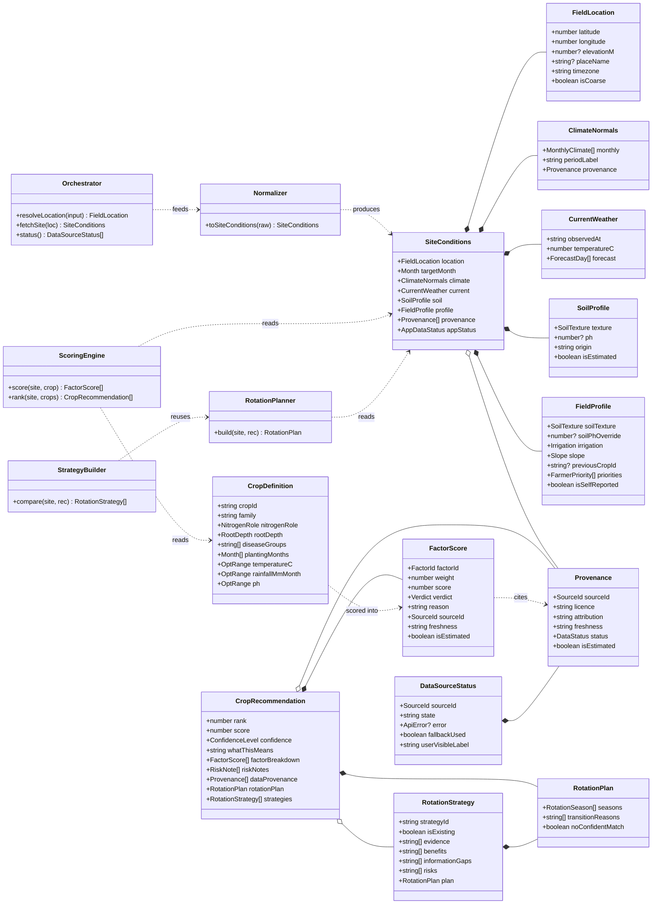
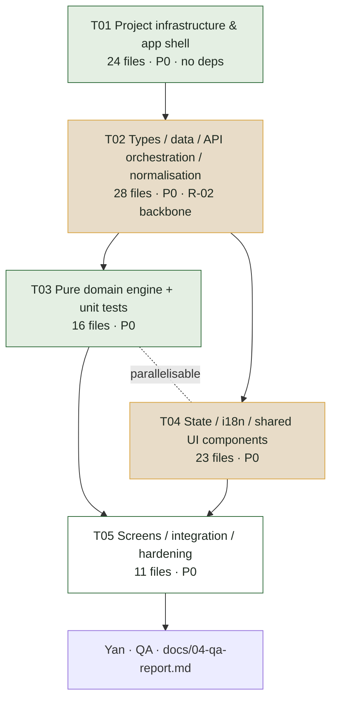

# Serumpun — System Design & Task Breakdown

| Field | Value |
|---|---|
| Document | `docs/02-architecture.md` — system design + ordered implementation plan |
| Author | Gao (高见远), Architect |
| Date | 2026-11-13 |
| Status | Ready for implementation (Kou) and QA (Yan) |
| Upstream (authoritative for **WHAT**) | `docs/01-prd.md` (Xu / PM), `docs/00-research-brief.md` (Qi / Delivery Director) |
| This document owns | **HOW**: platform, stack, file layout, types, algorithms, resilience, task order, conventions |
| Language | English (user's requirement language; brief §5) |
| Project root | `serumpun/` |

---

## 0. Scope authority & how to read this document

1. **Xu's PRD is authoritative for WHAT.** Every P0 requirement `R-01 … R-13`, the 7-factor weighted model (F1=20, F2=20, F3=15, F4=15, F5=10, F6=10, F7=10), the §5.2 recommendation schema, the §6.1 rotation schema and the §7.2 8-screen flow are preserved verbatim in this design. Where I extend scope (the ≥3 rotation *strategy comparison* from brief §2.1) I flag it explicitly in **§13 open item O-1** rather than silently changing it.
2. **Qi's brief §3 endpoint allowlist and §5 coordinator constraints are hard gates.** Only the keyless hosts verified in brief §3 plus static OSM raster tiles and NASA GIBS tiles may be called at runtime. Overpass is forbidden. SoilGrids is optional and never blocking.
3. **This doc contains no application code.** §4 types, §7 and §8 pseudocode are specifications for Kou. Diagrams are also extracted to `docs/class-diagram.mermaid` and `docs/sequence-diagram.mermaid`.
4. **Design principles applied:** simplicity, modularity, practicality (lean files, no needless abstractions), testability (scoring + rotation are pure, deterministic, network-free functions so Yan can test them offline).

---

## 1. Platform decision & justification

### 1.1 Final decision (confirming and refining brief §5)

> **Primary and only required platform: a browser-based responsive web app — Vite + React + TypeScript, mobile-first, PWA-ready, shipped as a pure static build with zero server-side component.**
>
> **Optional, fully decoupled: an Electron wrapper in a standalone `desktop/` folder with its OWN `package.json`, own `node_modules`, and own scripts. The root `npm install` / `npm run dev` / `npm run build` MUST NOT reference, import, or require Electron in any way.** Electron is P2 (PRD R-23) and is never on the critical path.

**Refinement I am adding to the coordinator constraint:** the web build must be a **pure static bundle** (HTML + JS + CSS + `public/` assets, no backend, no server-side rendering, no environment secrets). This means the app can be served from any free static host, opened from a local file share, or bundled into the Electron shell — with no hosting vendor, no account and no runtime service to keep alive. The service worker makes it work offline after a single successful visit; bundled sample data makes it work offline on the *very first* run even without a service worker.

### 1.2 Honest weighing against Electron-only

| Dimension | Electron-only | Web PWA (chosen) | Why it matters here |
|---|---|---|---|
| **Target device** | Requires a desktop/laptop OS. **Electron cannot run on Android at all.** | Runs in any cheap Android browser (Chrome/Finfish), the device every persona in PRD §2 actually owns. | Decisive. P1 Ibu Sari, P2 Pak Rahman and P3 Ayu all use cheap Android phones. An Electron-only build would literally have zero users. |
| **Install friction** | ~100–200 MB binary download + installer; sideloading or a store listing; store developer account and fees. | Zero install — open a link. Optional "Add to home screen" is one tap, free, no account. | Direct conflict with "no accounts, no fees, no vendor lock-in" and with G3 zero-friction. |
| **Metered 2G/3G cost** | Whole binary re-download for every update. | < 300 KB gzipped initial JS, incremental asset caching, all crop data bundled locally. | PRD §7.4 payload target; brief §4 low-bandwidth direction. |
| **Shared devices** | Install is per-machine and persistent; awkward for a co-op device used by 15–30 farmers. | Stateless per-tab session, localStorage only, no profile, no login. | P3 extension-worker persona (US-08, R-21). |
| **RAM** | Bundles a full Chromium (~150–300 MB resident) on top of the OS. | Uses the existing lightweight browser. | ≤ 2 GB RAM devices (PRD §2). |
| **Offline** | Naturally offline once installed (genuine advantage). | Offline via hand-written service worker + bundled sample payloads (equivalent after first visit; bundled data works even on first run). | Electron's one real advantage is neutralised. |
| **Store / fees / accounts** | Store listing needs a paid developer account; direct distribution needs trust/sideload. | None. | Non-negotiable §5 / PRD §8.3. |
| **Distribution / shareability** | Binary only. | A URL can be read aloud, printed on a card, shared over WhatsApp, used in group training. | P3 "shareable/printable field card" (R-21). |
| **Browser API variance** | None (fixed Chromium). | Geolocation permission, `fetch`, `AbortController`, `Intl` are all baseline in modern Android browsers; each has a documented fallback in §9. | Manageable and already required by PRD US-01. |

**Verdict:** Electron-only is not a viable platform for smallholders on cheap Android phones; the brief's PWA decision is correct and I confirm it. Electron remains useful only as a *later, optional* convenience for a desktop extension office (P3's village-hall laptop) — hence P2, isolated in `desktop/`.

### 1.3 Electron wrapper rules (so it never contaminates the root)

- `desktop/package.json` declares **only** `electron` as a devDependency. It has its own `npm install`. Root `package.json` has no `electron`, no `electron-builder`, no reference to `desktop/`.
- `desktop/main.js` creates one `BrowserWindow` loading `../dist/index.html`; `nodeIntegration: false`, `contextIsolation: true`, `webSecurity: true` (keyless `ACAO: *` endpoints work from `file://` with CORS). No IPC beyond a minimal, empty `preload.js`.
- If `dist/` is absent, `desktop/README.md` instructs: run root `npm run build` first. Root never depends on `desktop/`; `desktop/` depends on root's *output*, which is a one-directional, build-time-only relationship.

---

## 2. Framework & dependency selection (Implementation Approach)

### 2.1 Architecture pattern

**Layered, unidirectional, mostly-functional architecture** (a lightweight Flux/MVVM hybrid, not a heavy framework):

```
UI (screens + dumb components)
   ↕  dispatch / selectors
AppContext + useReducer  (single session state; localStorage persistence)
   ↓  calls pure domain functions with a normalised object
Domain engine  (scoring → recommendation → rotation → strategies → explain)
   ↑  reads
SiteConditions  (normalised, immutable per session)
   ↑  produced by
Normalizer  (units / month mapping / profile merge)
   ↑  fed by
API orchestrator  (parallel fetch, timeouts, cache, degradation, provenance)
   ↑  via
fetchWithTimeout + allowlist guard + coordinate cache
```

- **UI is a pure render of `AppState`** — no business logic in components.
- **Domain engine is pure and deterministic**: `f(SiteConditions, CropDefinition[]) → CropRecommendation[]`. No `fetch`, no `Date.now()`, no randomness. `targetMonth`, `lang` and `now` are passed in as arguments. This is what makes SC-2 / SC-5 / SC-6 testable offline.
- **No backend, no database, no server.** All "state" is a session object + localStorage.

### 2.2 Core technical challenges & how they are met

| Challenge | Design response |
|---|---|
| Keyless, unreliable, heterogeneous APIs | Single orchestrator with `Promise.allSettled`, per-source `AbortController` timeout, error isolation, coordinate-rounded cache, degraded-state machine, bundled sample fallback (§5, §9). |
| Explainability of every number | `FactorScore` carries `sourceId`, `freshness`, `isEstimated`; `Provenance[]` is assembled at fetch time and threaded unchanged through normalisation → scoring → UI. No orphan metrics (§4, §11). |
| Unit inconsistency (`PRECTOTCORR` mm/day vs monthly mm; `JAN..DEC` vs `1..12`; 0-based JS months) | One conversion module `normalize/units.ts` + `normalize/climate.ts`; canonical internal month = 1..12 integer (§7.9, §11). |
| Deterministic 3-season rotation with 6 hard rules | Small DFS over ≤ 40² candidate pairs with an explicit `isHardValid()` predicate; pure, exhaustive, unit-tested (§8). |
| Low bandwidth / ≤ 2 GB RAM | Lean dependency list, hand-built SVG charts, dynamic-imported Leaflet, no CSS framework, no chart lib, no i18n lib, no state lib (below). |
| Fully offline first run | `src/data/sample/*` contains real-shaped payloads; `AppDataStatus = 'Offline sample'` renders a complete recommendation + rotation (§9). |

### 2.3 Map approach — **Leaflet + OSM raster tiles + optional NASA GIBS true-colour overlay, dynamically imported, with a dependency-free solid-colour fallback**

- **Decision: use `leaflet@^1.9.4` (BSD-2-Clause, ~42 KB gz) as the ONLY runtime library beyond React.**
- Why not the dependency-free static map: PRD R-01 / US-01 `MUST` provide a **draggable map pin** and brief §3 / §8.1 explicitly allow static OSM raster tiles; PRD R-15 wants a GIBS layer toggle. A static image with a linear pixel→lat/lon mapping is cheap but inaccurate, cannot pan/zoom, cannot host a GIBS WMTS overlay and cannot show the Felt/komoot map patterns from brief §4. The 42 KB cost is acceptable **because it is code-split**: `FieldMap.tsx` uses `await import('leaflet')` only when S1/S2 mount, so the welcome → recommendations path never downloads it.
- Why not a heavier map stack (MapLibre GL / deck.gl): WebGL + vector tiles + style JSON is far too heavy and needs tile providers that often require keys.
- **Bandwidth guards:** OSM tiles are requested only on the two map screens (PRD §7.4 "imagery lazy-loaded and only on the map screen"); the GIBS overlay is **off by default** (R-15); tile failures hide the layer silently and fall back to a solid `#E4EFE3` background with the pin still draggable; `© OpenStreetMap contributors` (ODbL) is always visible; Nominatim is throttled to ≤ 1 req/s with a descriptive User-Agent.
- `config/endpoints.ts` builds OSM (`tile.openstreetmap.org/{z}/{x}/{y}.png`) and GIBS WMTS URLs (`MODIS_Terra_CorrectedReflectance_TrueColor` / `VIIRS_SNPP_CorrectedReflectance_TrueColor`, dynamic `YYYY-MM-DD`, fixed known-good fallback date). **Do NOT use `MODIS_Terra_NDVI_8Day`** — brief §3 reports 404.

### 2.4 Charts — **hand-built SVG + CSS, zero chart library**

- The P1 climate context (R-16) is a **12-bar temperature/rainfall chart** with the current month highlighted; the forecast (US-06) is a 16-day bar strip; the score ring (Lovi pattern) is a single SVG `<circle>` with `stroke-dasharray`; factor breakdowns are CSS bars; the KPI strip (7shifts) is CSS.
- Recharts / Chart.js / ApexCharts add 100–200 KB gz and a canvas runtime for ~28 rectangles. On metered 2G that is unjustifiable. Hand-built SVG is crisp at any DPI, themeable directly with the CSS custom properties from `tokens.css`, accessible (`<title>`/`<desc>` + a text table alternative for low literacy), and has **zero dependency and zero bundle cost**.
- Verdict: **no chart library**.

### 2.5 Styling — **plain CSS with custom properties; NO MUI, NO Tailwind**

- The design system is a **fixed 8-token palette** (PRD §7.4) with 8 screens and ~20 small components. MUI (`@mui/material` + `@emotion/*`) would add ~90–150 KB gz plus a theme runtime and would fight the custom earthy palette; its justification condition ("bundle cost") is not met. Tailwind adds a build step, config and purge discipline for a token set that is already 8 lines of CSS.
- Decision: `src/styles/tokens.css` (CSS variables), `global.css` (reset, type scale ≥16 px, ≥48 px tap targets, focus rings, 320 px layout), `utilities.css` (status badges, verdict chips). Theme is light-only in P0.
- Verdict encoding is **always icon + word** (PRD §7.5), never colour alone.

### 2.6 State, i18n, HTTP, dates, PWA — all dependency-free

| Concern | Choice | Rationale |
|---|---|---|
| State | React `useReducer` + `Context` (`AppContext.tsx`, `reducer.ts`) | One linear flow, one session object; no Redux/Zustand needed; reducer is pure and testable. |
| Persistence | `localStorage` via `state/persist.ts` | PRD Q7: no accounts → no sync/cloud. Keys namespaced `serumpun:*`. |
| i18n | `i18n/index.ts` `t(key, params)` + `en.ts` / `id.ts` dictionaries | ~2 KB. i18next is ~40 KB+ for 2 languages. No language gate before first use (US-10). |
| HTTP | native `fetch` + `AbortController` in `api/http.ts` | No axios. Every call has a timeout; no thrown exception escapes `api/`. |
| Dates / timezone | `Intl.DateTimeFormat` + `normalize/units.ts` | No date-fns/moment. `timezone=auto` from Open-Meteo resolves the target month (R-13). |
| Navigation | Screen enum in `reducer.ts` + a switch in `App.tsx` | 8-screen linear flow; `react-router` is unnecessary. |
| PWA | hand-written `public/sw.js` + `manifest.webmanifest` | No `vite-plugin-pwa`/Workbox. A ~40-line cache-first SW for the app shell + stale-while-revalidate for payloads suffices; keeps the build lean. |
| Validation | runtime checks in `domain/crops.ts` + unit tests | No zod/yup; crop JSON is authored in-repo and validated at load. |

### 2.7 Required Packages

Only `react@19.3.1` and `vite@8.3.8` are pinned from verified npm availability (brief §3 "Additional verification"). All others are **ranges to be resolved by `npm install` on first run** — if a peer conflict appears, bump the tool/plugin, do not downgrade React or Vite.

```
# runtime (shipped)
- react@19.3.1                 : UI framework
- react-dom@19.3.1             : DOM renderer
- leaflet@^1.9.4               : keyless OSM raster slippy map + draggable pin (lazy dynamic import, map screens only)

# build / dev only (never shipped)
- vite@8.3.8                   : dev server + static build
- @vitejs/plugin-react@latest  : JSX + Fast Refresh; MUST resolve to a release whose peerDependencies include vite ^8 (verify with `npm ls vite @vitejs/plugin-react` before writing app code)
- typescript@^5.9.0            : strict typing (or latest 5.x/6.x compatible with the plugin)
- @types/react@^19             : React 19 types
- @types/react-dom@^19         : ReactDOM 19 types
- @types/leaflet@^1.9.0        : Leaflet types
- vitest@^3.2.0               : unit-test runner for the pure domain functions (dev only; or latest compatible with Vite 8)

# desktop/ OWN package.json (P2, isolated, never installed by root)
- electron@latest              : devDependency of desktop/ ONLY
```

**Node requirement:** Vite 8 requires Node ≥ 20.19 or ≥ 22.12 — pin `.nvmrc` to the Node 22 LTS line. `tsconfig.json` uses `"strict": true`, `"noUncheckedIndexedAccess": true`, path alias `@/* → src/*` mirrored in `vite.config.ts` `resolve.alias` (no extra dependency).

### 2.8 Deliberately NOT used (release-gate list for Yan / SC-4)

`electron` (in root), `mui`, `@emotion/*`, `tailwindcss`, `recharts`, `chart.js`, `react-router-dom`, `redux`, `zustand`, `i18next`, `axios`, `date-fns`, `zod`, `vite-plugin-pwa`, `workbox-*`, any analytics/ads/telemetry/crash-reporting SDK, any SDK requiring an API key/token/account, and **the Overpass API**. `Overpass` must not appear in `config/endpoints.ts` or anywhere else.

---

## 3. Full file list (relative to `serumpun/`)

Every file Kou must create, grouped by layer. Batch ownership (T01–T05) is in §10. Files marked *(modify)* are created as skeletons in T01 and completed in T05.

### 3.1 Build / app-shell configuration (T01)

| # | Path | Purpose |
|---|---|---|
| 1 | `package.json` | Root deps + `dev` / `build` / `preview` / `test` scripts. **No electron.** |
| 2 | `package-lock.json` | Generated by `npm install`; commit it. |
| 3 | `tsconfig.json` | Strict TS, `@/*` alias, DOM libs. |
| 4 | `tsconfig.node.json` | Config-file TS for `vite.config.ts`. |
| 5 | `vite.config.ts` | React plugin, alias, build target, chunk splitting hint for Leaflet. |
| 6 | `index.html` | Single HTML shell, `<meta name="theme-color">`, manifest link, no inline scripts. |
| 7 | `.gitignore` | `node_modules`, `dist`, `desktop/node_modules`, `.env*`. |
| 8 | `.nvmrc` | Node 22 LTS pin. |
| 9 | `README.md` | Setup, no-secrets policy, full attribution, offline demo instructions. |

### 3.2 Static public assets (T01)

| # | Path | Purpose |
|---|---|---|
| 10 | `public/manifest.webmanifest` | PWA name, icons, `standalone`, theme `#FAF7F0`. |
| 11 | `public/sw.js` | Hand-written cache-first SW (app shell) + stale-while-revalidate (payloads). P1. |
| 12 | `public/icons/icon-192.png` | Install icon. |
| 13 | `public/icons/icon-512.png` | Install icon. |
| 14 | `public/icons/favicon.svg` | Light earthy mark. |

### 3.3 App shell + styles (T01)

| # | Path | Purpose |
|---|---|---|
| 15 | `src/main.tsx` | `createRoot`, register SW, mount `AppProvider`. *(modify in T05)* |
| 16 | `src/App.tsx` | Screen switch over `AppState.screen` + global `StatusBanner` / `Disclaimer` / `DataSourcesLink`. *(modify in T05)* |
| 17 | `src/vite-env.d.ts` | Vite + `*.json` module declarations. |
| 18 | `src/styles/tokens.css` | The 8 PRD §7.4 colour tokens as CSS variables + spacing/type tokens. |
| 19 | `src/styles/global.css` | Reset, ≥16 px body, ≥48 px tap targets, focus rings, 320 px layout. |
| 20 | `src/styles/utilities.css` | Status badges, verdict chips, `isEstimated` muted style, layout helpers. |

### 3.4 Optional desktop wrapper (T01, isolated, P2)

| # | Path | Purpose |
|---|---|---|
| 21 | `desktop/package.json` | Own deps: `electron` devDep only. Own scripts. |
| 22 | `desktop/main.js` | One `BrowserWindow` → `../dist/index.html`; `contextIsolation: true`, `nodeIntegration: false`. |
| 23 | `desktop/preload.js` | Minimal, empty, context-isolated. |
| 24 | `desktop/README.md` | P2 build/run notes; states root never needs Electron. |

### 3.5 Types (T02)

| # | Path | Purpose |
|---|---|---|
| 25 | `src/types/domain.ts` | All domain models: `FieldLocation`, `FieldProfile`, `ClimateNormals`, `CurrentWeather`, `SoilProfile`, `CropDefinition`, `SiteConditions`, `FactorId`, `FactorScore`, `CropRecommendation`, `RotationPlan`, `RotationSeason`, `RotationStrategy`, enums/unions. |
| 26 | `src/types/data.ts` | `SourceId`, `DataStatus`, `AppDataStatus`, `Provenance`, `DataSourceStatus`, `ApiError`, `FetchResult<T>`, `CacheEntry<T>`. |
| 27 | `src/types/ui.ts` | `Screen`, `AppState`, `AppAction`, `Lang`, `Verdict`, `ConfidenceLevel`, `CropVerdict`. |

### 3.6 Application constants / configuration (T02)

| # | Path | Purpose |
|---|---|---|
| 28 | `src/config/endpoints.ts` | **Single network allowlist** + URL builders for every brief §3 host, OSM tiles, GIBS WMTS. `assertAllowed(url)` lives here. |
| 29 | `src/config/sources.ts` | Per-source metadata: display name, licence, attribution string, timeout, cache TTL, fallback label, `isOptional`. |
| 30 | `src/config/scoring.ts` | The 7 weights (sum 100), factor display names, verdict bands, confidence bands, `MIN_SEASON_FIT`, season offsets (+4/+8), irrigation/rainfall constants. |
| 31 | `src/config/attribution.ts` | Exact attribution + licence strings + fixed disclaimer + tentative/climatology/forecast caveat strings. |

> Note: `src/config/*` are **application constants**, deliberately grouped with the data layer they configure (T02). All *build/tooling* config (`vite.config.ts`, `tsconfig*.json`, `package.json`) is in T01 only — no scatter.

### 3.7 Bundled data (T02)

| # | Path | Purpose |
|---|---|---|
| 32 | `src/data/crops.json` | **≥30 crops** (brief §5 list) with complete agronomic ranges + rotation tags + literature attribution key. |
| 33 | `src/data/sample/sampleLocation.ts` | Default sample location (Bogor/Jakarta, `-6.2088, 106.8456`), timezone, place name. |
| 34 | `src/data/sample/samplePowerClimatology.json` | Real-shaped POWER climatology payload (`JAN..DEC` + `ANN`, all 9 AG parameters). |
| 35 | `src/data/sample/sampleOpenMeteoForecast.json` | Current + 16-day daily payload with ET0 / shortwave / soil moisture. |
| 36 | `src/data/sample/sampleGeocode.json` | Open-Meteo geocoding result. |
| 37 | `src/data/sample/sampleNominatim.json` | Nominatim reverse result. |
| 38 | `src/data/sample/sampleSoilGrids.json` | SoilGrids result incl. a `mean: null` variant for tests. |

### 3.8 API / orchestration layer (T02)

| # | Path | Purpose |
|---|---|---|
| 39 | `src/api/http.ts` | `fetchWithTimeout<T>()`: `assertAllowed` → `AbortController` → timeout → parse → `FetchResult<T>`; converts every failure to `ApiError`, never throws across the module boundary. |
| 40 | `src/api/cache.ts` | Coordinate-rounded (3 dp) localStorage cache with TTL, `get`/`put`, stale-on-failure. |
| 41 | `src/api/geocode.ts` | Open-Meteo geocoding + manual lat/lon + GPS/pin passthrough. |
| 42 | `src/api/power.ts` | NASA POWER climatology / monthly / daily (9 AG parameters). |
| 43 | `src/api/openMeteo.ts` | Forecast + current (+ archive P1), `timezone=auto`, `elevation`. |
| 44 | `src/api/soilGrids.ts` | Optional, **8 s hard abort**, `mean: null` detection, never blocks. |
| 45 | `src/api/nominatim.ts` | Reverse geocode, descriptive UA, ≤1 req/s throttle, cached. |
| 46 | `src/api/orchestrator.ts` | `resolveLocation()` + `fetchSite()`: `Promise.allSettled`, per-source isolation, `AppDataStatus` reducer, bundled sample fallback, `Provenance[]` / `DataSourceStatus[]` assembly. **The R-02 backbone.** |

### 3.9 Normalisation layer (T02)

| # | Path | Purpose |
|---|---|---|
| 47 | `src/normalize/units.ts` | `daysInMonth`, `monthName`, `JAN..DEC ↔ 1..12`, 0-based `Date` → 1-based, modular month arithmetic, rounding helpers. |
| 48 | `src/normalize/climate.ts` | **PRECTOTCORR mm/day × days-in-month → monthly mm**; map POWER keys to `MonthlyClimate[12]`; wetness words; `ANN` kept separate. |
| 49 | `src/normalize/merge.ts` | Apply `FieldProfile` overrides + SoilGrids prefill; set `isEstimated` / `origin` flags. |
| 50 | `src/normalize/normalize.ts` | `toSiteConditions(raw, location, status, profile) → SiteConditions`. |
| 51 | `src/domain/crops.ts` | Load/validate/index `crops.json`; `getCrop`, `allCrops`, `cropsByFamily`, `neutralPrevCrop`. |
| 52 | `src/state/persist.ts` | localStorage read/write of last-good payloads + field profile (no cloud). |

### 3.10 Domain engine + tests (T03)

| # | Path | Purpose |
|---|---|---|
| 53 | `src/domain/membership.ts` | `trapezoid()`, `rampUp()`, `clamp()`, `modularMonthDistance()` — shared, pure math. |
| 54 | `src/domain/factors.ts` | The **7 factor scorers** `scoreF1…scoreF7(site, crop) → FactorScore`. |
| 55 | `src/domain/scoring.ts` | Weighted aggregation, verdict band, tie-break comparator. |
| 56 | `src/domain/confidence.ts` | Completeness 0–100 → `High/Medium/Low` + plain-language `confidenceReason`. |
| 57 | `src/domain/explain.ts` | Reason templates (via `t()`), `whatThisMeans`, `plantingWindow`, verdict text, transition reasons. |
| 58 | `src/domain/risks.ts` | Threshold checks → `RiskNote[]` (drought / heat / heavy rain / erosion / frost / pest-rotation). |
| 59 | `src/domain/rotation.ts` | `buildRotationPlan()` — DFS + 6 hard rules + `noConfidentMatch`. |
| 60 | `src/domain/strategies.ts` | `buildStrategies()` — **≥3 comparable strategies incl. existing rotation** (§8.4). |
| 61 | `src/domain/recommend.ts` | `recommend(site, lang) → CropRecommendation[]` — top-level pure orchestration of 53–60. |
| 62 | `tests/scoring.test.ts` | Weights sum, integer score, 7 factors, tie-break, estimated flags. |
| 63 | `tests/rotation.test.ts` | SC-5: 100 % of plans pass all 6 hard rules; unsatisfiable → honest state. |
| 64 | `tests/strategies.test.ts` | ≥3 strategies, one `isExisting`, all 4 evidence/benefits/gaps/risks populated. |
| 65 | `tests/normalize.test.ts` | PRECTOTCORR conversion, month mapping, leap-Feb rule, wrap-around windows. |
| 66 | `tests/orchestrator.test.ts` | Mocked fetch: timeout, `mean: null`, single-source failure, all-fail → offline sample. |
| 67 | `tests/confidence.test.ts` | Band boundaries 80 / 50; every reduction carries a reason. |
| 68 | `tests/fixtures/siteConditions.ts` | Deterministic `SiteConditions` fixture for all domain tests. |

### 3.11 State, i18n, shared components (T04)

| # | Path | Purpose |
|---|---|---|
| 69 | `src/state/AppContext.tsx` | Provider + `useApp()` hook. |
| 70 | `src/state/reducer.ts` | `AppState`, `AppAction`, `initialState`, pure transitions, `Screen` enum. |
| 71 | `src/i18n/index.ts` | `t(key, params)`, `lang` state, default `'en'`, no gate. |
| 72 | `src/i18n/en.ts` | English strings + reason templates. |
| 73 | `src/i18n/id.ts` | Bahasa Indonesia (P1). |
| 74 | `src/components/StatusBanner.tsx` | Persistent Live / Partly estimated / Offline sample + "Try again". |
| 75 | `src/components/DataSourcesLink.tsx` | One-tap S7 entry, present on every data-bearing screen. |
| 76 | `src/components/Disclaimer.tsx` | Fixed US-11 disclaimer, always visible. |
| 77 | `src/components/SourceLabel.tsx` | Source + freshness + `isEstimated` badge for every displayed number. |
| 78 | `src/components/EstimatedBadge.tsx` | Label + icon + muted style (never colour alone). |
| 79 | `src/components/ScoreRing.tsx` | SVG 0–100 ring (Lovi pattern). |
| 80 | `src/components/VerdictChip.tsx` | Good/Fair/Poor + icon + word. |
| 81 | `src/components/FactorCard.tsx` | One `FactorScore` → value / verdict / reason / source / freshness (Databricks card). |
| 82 | `src/components/KpiStrip.tsx` | Temp / rain / soil wetness / elevation with source + freshness (7shifts). |
| 83 | `src/components/ClimateChart.tsx` | SVG 12-month bars, current month highlighted, "long-term average" label. |
| 84 | `src/components/ForecastChart.tsx` | SVG 16-day rainfall / ET0, "forecast" label. |
| 85 | `src/components/MonthChips.tsx` | Month override (P1, R-19). |
| 86 | `src/components/CropCard.tsx` | Ranked crop card with score, verdict, window chip, "Why?" (Yuka). |
| 87 | `src/components/FieldMap.tsx` | **Lazy** `import('leaflet')`, draggable pin, OSM tiles, solid-colour fallback. |
| 88 | `src/components/GibsLayer.tsx` | Optional GIBS WMTS overlay, date selector, fixed fallback date, silent hide (P1). |
| 89 | `src/components/RiskNote.tsx` | One risk with triggering value + source. |
| 90 | `src/components/Stepper.tsx` | ≤3-step form shell, "I don't know" support. |
| 91 | `src/components/FieldCardExport.tsx` | Local download/print field card (P1, R-21). |

### 3.12 Screens + integration (T05)

| # | Path | Purpose |
|---|---|---|
| 92 | `src/screens/S0Welcome.tsx` | Promise, "Free · No account · No ads", status badge. |
| 93 | `src/screens/S1FindField.tsx` | Search / GPS / pin / manual coords (Apple Weather flow). |
| 94 | `src/screens/S2FieldSnapshot.tsx` | Map + legend + KPI strip + weather/climate summary (Felt + komoot). |
| 95 | `src/screens/S3FieldProfile.tsx` | 3 short steps (R-04). |
| 96 | `src/screens/S4Recommendations.tsx` | "For <Month> at <Place>", 3–5 ranked cards, scoring-method link. |
| 97 | `src/screens/S5WhyThisCrop.tsx` | Score ring + "What does this mean?" + factors + risks + disclaimer (Lovi/Cleo). |
| 98 | `src/screens/S6RotationPlan.tsx` | 3-season timeline, reason on every arrow, tentative notices. |
| 99 | `src/screens/S6StrategyCompare.tsx` | **≥3 comparable rotation strategies** incl. existing (§8.4; brief §2.1). |
| 100 | `src/screens/S7DataSources.tsx` | Source table + full attribution/licence text + "Refresh data". |
| 101 | `tests/integration.test.ts` | Offline end-to-end smoke: `recommend()` → plan → strategies from bundled data only. |
| 102 | `docs/03-code-summary.md` | Kou's implementation handoff notes (required deliverable per brief §5). |

**Also present but authored by others:** `docs/00-research-brief.md` (Qi), `docs/01-prd.md` (Xu), `docs/02-architecture.md` (this doc), `docs/04-qa-report.md` (Yan), `docs/class-diagram.mermaid` + `docs/sequence-diagram.mermaid` (extracted from this doc).

**Total files Kou creates: 102**, in 5 batches: T01=24, T02=28, T03=16, T04=23, T05=11.

---

## 4. Data structures & interfaces

### 4.1 TypeScript definitions (specification for `src/types/*.ts`)

```ts
// ---------- src/types/ui.ts : shared unions ----------
export type Month = 1|2|3|4|5|6|7|8|9|10|11|12;   // CANONICAL internal month, 1 = January
export type FactorId = 'F1'|'F2'|'F3'|'F4'|'F5'|'F6'|'F7';
export type ConfidenceLevel = 'High' | 'Medium' | 'Low';
export type Verdict = 'Good' | 'Fair' | 'Poor';                     // factor-level
export type CropVerdict = 'Good fit' | 'Worth considering' | 'Poor fit';
export type NitrogenRole = 'Legume' | 'Heavy feeder' | 'Light feeder';
export type RootDepth = 'Shallow' | 'Medium' | 'Deep';
export type WaterNeed = 'Low' | 'Medium' | 'High';
export type Difficulty = 'Easy' | 'Moderate' | 'Demanding';
export type SoilTexture = 'sandy' | 'loam' | 'clay' | 'peat' | 'unknown';
export type Irrigation = 'none' | 'partial' | 'reliable' | 'unknown';
export type Slope = 'flat' | 'gentle' | 'steep' | 'unknown';
export type Shade = 'none' | 'partial' | 'heavy' | 'unknown';
export type SurroundingTag = 'nearby-water' | 'nearby-forest' | 'nearby-urban' | 'none-known';
export type FarmerPriority =
  | 'low-water' | 'drought-tolerance' | 'nitrogen-fixation' | 'erosion-reduction'
  | 'organic-matter' | 'forage' | 'quick-harvest' | 'market-suitability' | 'low-labour';
export type BotanicalFamily = string;   // 'Poaceae','Fabaceae','Solanaceae','Brassicaceae',
                                        // 'Cucurbitaceae','Euphorbiaceae','Amaranthaceae',
                                        // 'Zingiberaceae','Musaceae','Araceae', ...
export type Lang = 'en' | 'id';
export type Screen =
  | 'S0_WELCOME' | 'S1_FIND_FIELD' | 'S2_SNAPSHOT' | 'S3_PROFILE'
  | 'S4_RECOMMENDATIONS' | 'S5_WHY' | 'S6_ROTATION' | 'S6_STRATEGY_COMPARE'
  | 'S7_DATA_SOURCES';

// ---------- src/types/data.ts : provenance / resilience ----------
export type SourceId =
  | 'NASA_POWER' | 'NASA_GIBS' | 'OPEN_METEO' | 'SOILGRIDS'
  | 'NOMINATIM' | 'OSM_TILES' | 'BUNDLED' | 'USER';
export type DataStatus = 'live' | 'cached' | 'estimated' | 'self-reported' | 'bundled sample';
export type AppDataStatus = 'Live' | 'Partly estimated' | 'Offline sample';

export interface Provenance {
  sourceId: SourceId;
  source: string;              // display name, e.g. "NASA POWER"
  contribution: string;        // what it gave us, plain words
  licence: string;             // e.g. "CC BY 4.0"
  attribution: string;         // full in-app attribution text (R-12)
  retrievedAt: string | null;  // ISO 8601 UTC, null for static climatology
  freshness: string;           // display: timestamp OR "long-term average 1991–2020"
  status: DataStatus;
  isEstimated: boolean;
  url?: string;                // exact endpoint called; NEVER contains a key/token
  cacheKey?: string;
}
export interface ApiError {
  sourceId: SourceId;
  kind: 'timeout' | 'http' | 'parse' | 'null-mean' | 'offline' | 'blocked-host' | 'rate-limit';
  message: string;             // plain words, no error codes surfaced to the user
  statusCode?: number;
  at: string;                  // ISO 8601 UTC
}
export interface FetchResult<T> {
  ok: boolean;
  data: T | null;
  error: ApiError | null;
  provenance: Provenance;
  fromCache: boolean;
}
export interface CacheEntry<T> {
  key: string; payload: T; storedAt: string; ttlMs: number; provenance: Provenance;
}
export interface DataSourceStatus {
  sourceId: SourceId;
  state: 'idle' | 'loading' | 'ok' | 'degraded' | 'failed' | 'skipped';
  status: DataStatus;
  startedAt: string | null;
  completedAt: string | null;
  durationMs: number | null;
  timeoutMs: number;
  cacheTtlMs: number;
  error: ApiError | null;
  fallbackUsed: boolean;
  userVisibleLabel: string;    // e.g. "Some data is estimated"
  provenance: Provenance;
}

// ---------- src/types/domain.ts : models ----------
export interface FieldLocation {
  latitude: number;            // WGS84
  longitude: number;
  elevationM: number | null;   // Open-Meteo / POWER geometry
  placeName: string | null;    // Nominatim reverse or geocode name
  adminContext: string | null; // "Bogor, West Java, Indonesia"
  timezone: string;            // IANA, Open-Meteo timezone=auto
  resolvedBy: 'search' | 'gps' | 'pin' | 'manual' | 'sample';
  isCoarse: boolean;           // coarse geocode → reduces confidence
  source: SourceId;
  retrievedAt: string | null;
}
export interface FieldProfile {
  soilTexture: SoilTexture;                      // 'unknown' allowed
  soilPhOverride: number | null;                 // 4.0–9.0, user override
  irrigation: Irrigation;
  slope: Slope;
  shade: Shade;
  previousCropId: string | null;                 // FK into crops.json; null = none/unknown
  previousCropUnknown: boolean;                  // explicit "I don't know"
  landSizeHa: number | null;
  surroundings: SurroundingTag[];
  priorities: FarmerPriority[];                  // challenge §2.1 (see open item O-2)
  answered: Partial<Record<
    'soil' | 'irrigation' | 'slope' | 'shade' | 'previousCrop' | 'landSize' | 'surroundings',
    'answered' | 'unknown'>>;
  isSelfReported: boolean;                       // true when SoilGrids failed / manual picker used
}
export interface MonthlyClimate {
  month: Month;                 // 1..12
  t2mC: number; t2mMaxC: number; t2mMinC: number;
  precipMm: number;             // PRECTOTCORR(mm/day) × daysInMonth
  rhPct: number;
  solarMjM2Day: number;         // ALLSKY_SFC_SW_DWN
  windMs10m: number;            // WS10M
  gwetRoot: number;             // 0..1 relative wetness (NOT volumetric moisture)
  gwetTop: number;
  et0MmDay: number | null;      // Open-Meteo daily ET0 (FAO), else null
}
export interface ClimateNormals {
  monthly: MonthlyClimate[];    // EXACTLY 12, index 0 = January
  annual: { t2mC: number; precipMm: number } | null;   // ANN kept separate, never a month
  periodLabel: string;          // "long-term monthly average 1991–2020"
  source: SourceId;
  provenance: Provenance;
}
export interface ForecastDay {
  date: string;                 // ISO date
  tMaxC: number; tMinC: number; precipMm: number;
  et0Mm: number | null; solarMjM2: number | null;
}
export interface CurrentWeather {
  observedAt: string;           // ISO 8601 UTC timestamp (REQUIRED for live values)
  temperatureC: number;
  humidityPct: number;
  precipitationMm: number;
  soilMoisture01: number | null;  // Open-Meteo soil_moisture_0_to_1cm
  forecast: ForecastDay[];        // ≤16 days
  timezone: string;
  elevationM: number | null;
  source: SourceId;
  provenance: Provenance;
}
export interface SoilProfile {
  texture: SoilTexture;
  ph: number | null;
  clayPct: number | null;
  sandPct: number | null;
  socGkg: number | null;
  depthLabel: string;             // "0-5cm"
  origin: 'soilgrids' | 'self-reported' | 'bundled' | 'unknown';
  isEstimated: boolean;
  provenance: Provenance;
}
export interface Range { min: number; max: number; }                       // inclusive
export interface OptRange { min: number; optMin: number; optMax: number; max: number; } // trapezoid
export interface CropDefinition {
  cropId: string;                 // kebab-case, stable
  cropName: string;               // English
  localName?: string;             // Bahasa Indonesia (optional)
  family: BotanicalFamily;
  nitrogenRole: NitrogenRole;
  rootDepth: RootDepth;
  diseaseGroups: string[];        // e.g. ['solanaceae-blight'], ['cucurbit-wilt']
  plantingMonths: Month[];
  plantingWindow: { startMonth: Month; endMonth: Month; bestMonth: Month };
  daysToHarvest: Range;           // e.g. { min: 90, max: 120 }
  waterNeed: WaterNeed;
  difficulty: Difficulty;
  difficultyReason: string;
  requirements: {
    temperatureC: OptRange;       // °C (min/optMin/optMax/max)
    rainfallMmMonth: OptRange;    // monthly total mm
    ph: OptRange;                 // 4.0–9.0
    elevationM: Range;            // metres
    texture: SoilTexture[];       // acceptable textures
    drainageTolerance: 'low' | 'medium' | 'high';
    slopeTolerance: Slope[];
    shadeTolerance: Shade[];
    frostTolerant: boolean;
    heatStressC: number;          // °C threshold for heat risk
    heavyRainMmDay: number;       // mm/day threshold for heavy-rain / erosion risk
  };
  notes: string;                  // literature-based heuristic caveat
  literature: string;             // attribution key, e.g. 'EcoCrop / FAO GAEZ-style'
}
/** The single normalised object every domain function consumes. */
export interface SiteConditions {
  location: FieldLocation;
  targetMonth: Month;             // resolved from timezone (R-13)
  climate: ClimateNormals;
  current: CurrentWeather;
  soil: SoilProfile;
  profile: FieldProfile;          // user overrides already merged by normalize/merge.ts
  monthlyForTarget: MonthlyClimate;
  provenance: Provenance[];
  sources: DataSourceStatus[];
  appStatus: AppDataStatus;
}
export interface FactorScore {     // EXACT PRD §5.2 factorBreakdown entry
  factorId: FactorId;
  name: string;                   // stable human name, published in "Scoring method"
  weight: number;                 // 20/20/15/15/10/10/10
  observedValue: string;          // display string WITH unit, e.g. "27 °C"
  rawValue: number | null;        // traceable raw value (tap / tests)
  unit: string;
  score: number;                  // 0..100 for this factor
  verdict: Verdict;               // Good / Fair / Poor
  reason: string;                 // ONE plain sentence
  source: string;                 // display name
  sourceId: SourceId;
  freshness: string;              // timestamp OR "long-term average 1991–2020"
  isEstimated: boolean;
}
export interface PlantingWindow {
  status: 'Plant now' | 'Wait until <Month>' | 'Out of season';
  startMonth: Month; endMonth: Month; bestMonth: Month; note: string;
}
export interface RiskNote {
  type: 'drought' | 'heat' | 'heavy rain' | 'erosion' | 'frost' | 'pest-rotation';
  severity: 'low' | 'medium' | 'high';
  plainText: string; source: string; freshness: string;
}
export interface CropRecommendation {   // EXACT PRD §5.2 schema
  rank: number;                          // 1-based, score desc
  cropId: string; cropName: string; localName?: string;
  score: number;                         // INTEGER 0–100, no decimals, never a probability/yield
  confidence: ConfidenceLevel;
  confidenceReason: string;
  completenessScore: number;             // internal 0–100, NOT displayed
  verdict: CropVerdict;
  factorBreakdown: FactorScore[];        // ≥5; we always emit all 7
  whatThisMeans: string;                 // 2–3 plain sentences, ≤8th-grade
  plantingWindow: PlantingWindow;
  daysToHarvest: Range;                  // labelled "typical, varies by variety and care"
  waterNeed: WaterNeed; waterNeedNote: string;
  difficulty: Difficulty; difficultyReason: string;
  riskNotes: RiskNote[];
  dataProvenance: Provenance[];
  rotationPlan: RotationPlan;
  strategies: RotationStrategy[];        // ≥3, see §8.4
  disclaimer: string;                    // fixed US-11 text
  targetMonth: Month;
}
export interface RotationSeason {        // PRD §6.1
  seasonIndex: 1 | 2 | 3;
  periodLabel: string;                   // "Season 1 · Planting now" / "Mar 2027 – Jun 2027"
  targetMonth: Month;
  cropId: string; cropName: string; family: BotanicalFamily;
  nitrogenRole: NitrogenRole; rootDepth: RootDepth;
  fitScore: number;                      // for that target month (climatology, NOT forecast)
  confidence: ConfidenceLevel;
  reasons: string[];                     // one per applicable rule
  cautions: string[];
  tentative: boolean;                    // true for 2,3
  tentativeNotice?: string;              // "Tentative — check conditions again before planting."
}
export interface RotationPlan {          // PRD §6.1: exactly 3 seasons
  seasons: [RotationSeason, RotationSeason, RotationSeason];
  transitionReasons: [string, string, string];  // prev→S1, S1→S2, S2→S3
  previousCrop: { cropId: string | null; assumedNeutral: boolean; note: string };
  strategyId: string;
  noConfidentMatch: boolean;
  noMatchNote?: string;
  disclaimer: string;
}
export interface RotationStrategy {      // brief §2.1 / challenge statement (see O-1)
  strategyId: string;                    // 'existing' | 'balanced' | 'soil-restoring' | 'water-saving' | 'quick-income'
  label: string;                         // "Your current rotation"
  isExisting: boolean;
  summary: string;                       // why suggested
  plan: RotationPlan;
  evidence: string[];                    // supporting evidence w/ source + freshness refs
  benefits: string[];
  informationGaps: string[];
  risks: string[];                       // risks needing LOCAL review
  vulnerableSeasons: string[];           // bare-field / vulnerable periods
  comparison: {
    soilHealthScore: number;
    waterDemand: WaterNeed;
    nitrogenBalance: 'building' | 'neutral' | 'depleting';
    bareFieldWeeks: number;
    ruleViolations: number;
    avgFitScore: number;
  };
}
```

### 4.2 Mermaid class diagram (also in `docs/class-diagram.mermaid`)



---

## 5. Program call flow (also in `docs/sequence-diagram.mermaid`)

```mermaid
sequenceDiagram
    autonumber
    actor U as Farmer
    participant UI as UI Screens
    participant ST as AppContext Reducer
    participant OR as Orchestrator
    participant HT as fetchWithTimeout
    participant AL as Allowlist Guard
    participant CA as Coordinate Cache
    participant GEO as Open-Meteo Geocoding
    participant POW as NASA POWER
    participant OM as Open-Meteo Forecast
    participant SG as ISRIC SoilGrids
    participant NOM as Nominatim
    participant GIB as GIBS and OSM Tiles
    participant SD as Bundled Sample Data
    participant NM as Normalizer
    participant DB as CropDB
    participant SE as ScoringEngine
    participant RP as RotationPlanner
    participant SB as StrategyBuilder

    U->>UI: S0 to S1 pick location (search / GPS / pin / manual coords)
    UI->>ST: dispatch SET_LOCATION_PENDING
    ST->>OR: resolveLocation(input)
    OR->>HT: GET geocoding (timeout 6s, AbortController)
    HT->>AL: assertAllowed(url)
    AL-->>HT: ok (host on allowlist)
    HT->>CA: read cache key name
    alt cache hit and fresh
        CA-->>OR: FieldLocation status=cached
    else miss or geocode fails
        HT->>GEO: GET geocoding-api.open-meteo.com
        GEO-->>HT: JSON or error
        HT-->>OR: FetchResult
        OR->>SD: bundled sample location
        SD-->>OR: FieldLocation status=bundled sample
    end
    OR->>HT: GET Nominatim reverse (1 req/s, descriptive UA)
    HT->>NOM: reverse zoom=10
    NOM-->>HT: place / admin context
    Note over OR,NOM: optional; failure yields "Area not named", never blocks
    OR-->>ST: FieldLocation + Provenance[]

    ST->>OR: fetchSite(location)
    par parallel fetches via Promise.allSettled (per-source isolation)
        OR->>HT: POWER climatology (10s)
        HT->>POW: 9 AG params, JAN..DEC + ANN
        POW-->>HT: JSON
        HT->>CA: put TTL 30d key lat3:lon3
    and
        OR->>HT: Open-Meteo forecast + current (8s)
        HT->>OM: current + daily 16d, timezone=auto
        OM-->>HT: JSON with elevation / ET0 / soil_moisture
        HT->>CA: put TTL 1h current / 3h forecast
    and
        OR->>HT: Open-Meteo archive 5y (P1, 10s)
        HT->>OM: archive daily precip / temp
        OM-->>HT: JSON or error (view hidden on failure)
    and
        OR->>HT: ISRIC SoilGrids (8s HARD AbortController)
        HT->>SG: phh2o/clay/sand/soc 0-5cm mean
        SG-->>HT: JSON with mean:null or timeout
        Note over OR,SG: mean:null / timeout -> manual soil picker labelled self-reported; NEVER blocks
        HT->>CA: put TTL 30d key lat3:lon3
    and
        OR->>HT: OSM raster tiles + optional GIBS overlay (lazy, map screens only)
        HT->>GIB: tile requests, 6s each
        GIB-->>HT: JPEG/PNG or failure -> solid-colour fallback
    end
    HT-->>OR: FetchResult[] each with Provenance + status
    OR->>OR: reduce to AppDataStatus Live / Partly estimated / Offline sample
    alt all sources failed OR navigator.onLine is false
        OR->>SD: load sample POWER / forecast / geocode / soil payloads
        SD-->>OR: raw payloads, every factor isEstimated=true
    end
    OR->>NM: toSiteConditions(raw, location, status)
    NM->>NM: PRECTOTCORR mm/day x daysInMonth -> monthly mm
    NM->>NM: JAN..DEC -> Month 1..12; timezone -> targetMonth; ANN kept aside
    NM->>NM: merge FieldProfile overrides + SoilGrids prefill, set isEstimated
    NM-->>ST: SiteConditions + Provenance[] + DataSourceStatus[]
    ST-->>UI: render S2 Field snapshot (KPI strip with source + freshness)

    U->>UI: S3 Field profile (3 steps, "I don't know" allowed everywhere)
    UI->>ST: dispatch SET_PROFILE
    ST->>NM: re-merge profile overrides
    NM-->>ST: updated SiteConditions

    ST->>SE: rank(SiteConditions, DB.all(), lang, targetMonth)
    SE->>DB: load + validate crops.json
    loop for each crop (approx 30-40)
        SE->>SE: 7 pure factor scorers, trapezoidal membership
        SE->>SE: weighted sum -> integer score 0..100
        SE->>SE: confidence (completeness -> High/Medium/Low + reason)
    end
    SE->>SE: sort score desc, confidence desc, completeness desc, cropId asc
    SE-->>ST: top 3-5 CropRecommendation (rotation not yet attached)

    ST->>RP: build(SiteConditions, each top recommendation)
    RP->>RP: DFS over S2/S3 candidates, enforce 6 hard rules
    RP-->>ST: RotationPlan (3 seasons + transitionReasons + cautions)
    ST->>SB: compare(SiteConditions, recommendation, plans)
    SB->>SB: build >=3 strategies including existing rotation
    SB-->>ST: RotationStrategy[] with evidence / benefits / gaps / risks
    ST->>ST: attach rotationPlan + strategies to CropRecommendation
    ST-->>UI: render S4 -> S5 -> S6 -> S6 compare -> S7
    UI-->>U: ranked crops, Why this crop, 3-season plan, strategy compare, Data and sources
    Note over U,UI: persistent status banner + Try again + decision-support disclaimer always visible
```

**Flow invariants:** geocoding is a *prerequisite* (coordinates are needed before POWER/Open-Meteo), then all other sources run in parallel. Every `HT` arrow passes through `assertAllowed` + `AbortController`. Every returned object carries its `Provenance`. No step throws to the UI. No step waits indefinitely.

---

## 6. Module responsibilities

| Module | Owns | MUST NOT | Key exports |
|---|---|---|---|
| **API layer** (`src/api/*`) | Building allowlisted URLs, `fetch` with `AbortController` timeout, TTL cache keyed by rounded coord, converting raw JSON/errors to `FetchResult<T>` + `Provenance`, parallel `allSettled`, `AppDataStatus` reduction, bundled sample fallback. | Call non-allowlisted hosts; throw across the boundary; block on SoilGrids; call Overpass; include keys/tokens; conflate live vs cached vs estimated. | `fetchWithTimeout`, `assertAllowed`, `cacheGet/Put`, `resolveLocation`, `fetchSite`, `getDataSourceStatuses` |
| **Normalisation layer** (`src/normalize/*`) | Unit conversion (`PRECTOTCORR`), `JAN..DEC → 1..12`, `ANN` separation, timezone→target month, rounding, wetness words, merging `FieldProfile` overrides + SoilGrids prefill, setting `isEstimated` / `origin`. | Fetch; make agronomic judgements; lose provenance; use `ANN` as a month. | `toSiteConditions`, `powerToClimateNormals`, `monthFromTimezone`, `daysInMonth`, `mergeProfile` |
| **Crop database** (`src/data/crops.json`, `src/domain/crops.ts`) | ≥30 curated crops with all agronomic ranges + rotation tags + literature attribution; load-time validation; index by id/family/role/depth. It is the domain engine's **only** agronomic knowledge source. | Call any network; invent thresholds without a `literature` key; present heuristics as guarantees. | `allCrops`, `getCrop`, `cropsByFamily`, `neutralPrevCrop`, `validateCropDB` |
| **Scoring engine** (`domain/membership|factors|scoring|confidence|risks|recommend`) | 7 pure factor scorers, weighted sum, verdict, tie-break, confidence band + reason, risk notes, top-N ranking. Deterministic. | `fetch`, `Date.now()`, randomness, UI strings inline (reasons go through `explain.ts`), hide `isEstimated`. | `scoreF1…F7`, `aggregateScore`, `computeConfidence`, `buildRiskNotes`, `recommend` |
| **Rotation planner** (`domain/rotation.ts`) | `isHardValid()` enforcing the 6 hard rules, exhaustive DFS over S2/S3 candidates, season fit from monthly climatology, `noConfidentMatch` honest state, 3 `transitionReasons`. | Silently violate a rule; fabricate a previous crop; use forecast for future seasons; invent a confident plan. | `buildRotationPlan`, `isHardValid`, `seasonFitScore` |
| **Strategy builder** (`domain/strategies.ts`) | ≥3 comparable `RotationStrategy` objects incl. `existing`; per-strategy evidence / benefits / information gaps / risks / vulnerable seasons / comparable metrics. | Present inferred "existing rotation" as known history; omit the disclaimer. | `buildStrategies`, `buildExistingStrategy` |
| **Explanation formatter** (`domain/explain.ts`, `src/i18n/*`) | All human sentences: reason templates, `whatThisMeans`, planting-window text, transition reasons, cautions, verdict labels. `t()` is a pure dictionary lookup; `lang` is passed in. | Hardcode English inside the domain engine in a way that blocks `id`; use jargon; show decimals; add numbers without units/source. | `t`, `explainFactor`, `whatThisMeans`, `plantingWindowText`, `transitionReason` |
| **State management** (`src/state/*`) | One `AppState` (screen, location, site, profile, recommendations, selected crop, statuses, lang), pure reducer, localStorage persistence of last-good payload + profile. | Store secrets; call network in the reducer; sync to any cloud; keep PII. | `AppProvider`, `useApp`, `reducer`, `initialState`, `load/savePersisted` |
| **UI** (`src/screens/*`, `src/components/*`) | Render `AppState`; dispatch actions; lazy-load Leaflet; SVG charts; status banner; disclaimer; one primary action per screen; `SourceLabel` on every number; ≥48 px targets; 320 px. | Contain business logic; display an orphan number; show `NaN`/blank/spinner forever; rely on colour alone; gate on language/account. | screen components, `ScoreRing`, `ClimateChart`, `FieldMap`, `StatusBanner` |

---

## 7. Scoring engine algorithm

### 7.0 Shared membership functions (`domain/membership.ts`)

```text
trapezoid(v, min, optMin, optMax, max) -> 0..100
    if v <= min OR v >= max            : return 0
    if min < v < optMin               : return 100 * (v - min) / (optMin - min)
    if optMin <= v <= optMax          : return 100
    if optMax < v < max               : return 100 * (max - v) / (max - optMax)

rampUp(v, low, high)   -> clamp(100 * (v - low) / (high - low), 0, 100)
clamp(v, lo, hi)       -> min(hi, max(lo, v))
modularMonthDistance(a, b) -> min(|a-b|, 12-|a-b|)      // handles Nov-Feb wrap-around windows
```

**Global rule:** a factor scoring 0 does **not** remove a crop — this is decision support, not a hard filter. Only `F4` sets `plantingWindow.status`; only the rotation planner applies hard rejects. Every factor returns a `FactorScore` with `reason`, `sourceId`, `freshness`, `isEstimated`.

### 7.1 F1 — Temperature fit · weight **20**

- **Input:** `site.monthlyForTarget.{t2mC, t2mMaxC, t2mMinC}`; `crop.requirements.temperatureC {min,optMin,optMax,max}`, `heatStressC`, `frostTolerant`.
- **Ideal range:** the crop's trapezoid optimum `[optMin, optMax]` °C; hard bounds `[min, max]`.
- **Scoring:**
  ```text
  base    = trapezoid(t2mC, min, optMin, optMax, max)
  heatPen = clamp((t2mMaxC - heatStressC) / 5, 0, 1) * 20
  frostPen= frostTolerant ? 0 : clamp((5 - t2mMinC) / 5, 0, 1) * 20
  score   = clamp(base - heatPen - frostPen, 0, 100)
  ```
- **Verdict:** ≥75 Good, ≥45 Fair, else Poor.
- **Reason template:** `"{Month} averages {T} °C. {Crop} grows best at {optMin}–{optMax} °C, so this is {verdict}."` + optional `"Hot days near {max} °C can stress it."` / `"Cool nights near {min} °C are a frost risk."`
- **Missing / estimated:** if `climate.provenance.status !== 'live'`, `isEstimated = true`, use the bundled/climatology value, subtract from completeness (§7.8) — never block.

### 7.2 F2 — Water fit · weight **20**

- **Input:** `monthlyForTarget.precipMm` (monthly mm), `et0MmDay`, `gwetRoot/gwetTop`, `crop.requirements.rainfallMmMonth`, `crop.waterNeed`, `crop.requirements.heavyRainMmDay`, `profile.irrigation`.
- **PRECTOTCORR conversion (MANDATORY, see §7.9):** POWER climatology returns `mm/day`; `precipMm = PRECTOTCORR[m] * daysInMonth(m)`.
- **Scoring:**
  ```text
  irrigationBonus = {none:0, partial:30, reliable:80, unknown:0}[irrigation]   // mm/month
  demandMm        = {Low:60, Medium:110, High:180}[waterNeed]
                    + (et0MmDay != null ? et0MmDay * daysInMonth(m) * 0.35 : 0)
  supplyMm        = precipMm + irrigationBonus
  ratio           = supplyMm / demandMm
  base            = trapezoid(ratio, 0.40, 0.85, 1.30, 2.20)
  wetnessMod      = gwetRoot < 0.25 ? -10 : (gwetRoot > 0.75 ? +5 : 0)
  waterlogPen     = ratio > 2.2 ? clamp((ratio - 2.2) * 25, 0, 25) : 0
  score           = clamp(base + wetnessMod - waterlogPen, 0, 100)
  ```
- **Reason template:** `"{Month} usually brings {rain} mm of rain. {Crop} needs {Low/Medium/High} water; with {irrigation} irrigation this looks {verdict}."`
- **Missing / estimated:** ET0 null → demand falls back to the `waterNeed` constant, `isEstimated = true`. Irrigation `unknown` → no bonus, `isEstimated = true`. `GWETROOT` is a **0–1 relative wetness**, never volumetric moisture; display as `dry / moist / wet` words with raw value on tap.

### 7.3 F3 — Soil fit · weight **15**

- **Input:** `site.soil.{texture, ph}` (or `profile.soilPhOverride` wins), `crop.requirements.{ph, texture[], drainageTolerance}`.
- **Scoring:**
  ```text
  phScore  = soil.ph == null ? 50 : trapezoid(soil.ph, ph.min, ph.optMin, ph.optMax, ph.max)
  texScore = soil.texture == 'unknown' ? 50
           : soil.texture in crop.requirements.texture ? 100
           : adjacentTexture(soil.texture, crop.requirements.texture) ? 45 : 10
  drainPen = (soil.texture == 'clay' AND drainageTolerance == 'low') ? 20 : 0
  score    = clamp(0.6*phScore + 0.4*texScore - drainPen, 0, 100)
  ```
- **Reason template:** `"Soil here is {sandy/loam/clay/peat}{, pH X}. {Crop} prefers {list} and pH {range} — {verdict}."`
- **Missing / estimated:** `origin === 'self-reported' | 'bundled' | 'unknown'` → `isEstimated = true`, completeness reduced. SoilGrids `origin === 'soilgrids'` → still `isEstimated = true` **and** labelled "estimated" (PRD US-03: pre-fill must be labelled estimated even on success). `pH` override always wins over SoilGrids and is labelled "self-reported".

### 7.4 F4 — Season / planting window · weight **15**

- **Input:** `site.targetMonth`, `crop.plantingWindow {startMonth, endMonth, bestMonth}`, plus `F1+F2` recomputed from `climate.monthly[m]` for wrap-around windows.
- **Scoring (modular, handles Nov→Feb):**
  ```text
  inWindow   = monthWithinWindow(targetMonth, startMonth, endMonth)   // modular
  d          = modularMonthDistance(targetMonth, bestMonth)
  score = targetMonth == bestMonth ? 100
        : inWindow                ? 85
        : d <= 1                  ? 55     // "Wait until <Month>"
        :                           20     // "Out of season"
  plantingWindow.status = score>=85 ? 'Plant now'
                        : score==55 ? 'Wait until <Month>'
                        : 'Out of season'
  ```
- **Reason template:** `"{Month} is {inside / just before / outside} the usual planting window for {Crop} ({start}–{end})."`
- **Note:** future seasons (§8) use the **same** `climate.monthly[m]` (`JAN..DEC`) — never the 16-day forecast — for season fit.

### 7.5 F5 — Terrain & erosion · weight **10**

- **Input:** `profile.slope`, `location.elevationM`, `monthlyForTarget.precipMm / days` (heavy-rain proxy), `crop.requirements.{elevationM, slopeTolerance, heavyRainMmDay}`.
- **Scoring:**
  ```text
  elevScore   = elevationM == null ? 60 : trapezoid(elevationM, elev.min, elev.min+100, elev.max-100, elev.max)
  slopeScore  = slope == 'unknown' ? 60 : (slope in slopeTolerance ? 100 : slope=='steep' ? 25 : 55)
  heavyRisk   = (precipMm / daysInMonth(m)) > heavyRainMmDay
  erosionPen  = (slope=='steep' AND heavyRisk) ? 30 : (heavyRisk ? 10 : 0)
  score       = clamp(0.5*elevScore + 0.5*slopeScore - erosionPen, 0, 100)
  ```
- **Reason template:** `"Your field is {flat/gentle/steep} at about {elev} m. {Crop} tolerates {slopes}; heavy rain could wash soil on steep ground."`

### 7.6 F6 — Surroundings & field context · weight **10**

- **Input:** `profile.{irrigation, shade, surroundings, landSizeHa}`, `location.adminContext` (Nominatim), `crop.requirements.shadeTolerance`.
- **Scoring:** start from a neutral `70`, then bounded modifiers:

  | Modifier | Δ |
  |---|---|
  | irrigation reliable / partial | +10 / +5 |
  | shade `heavy` and crop not shade-tolerant | −15 |
  | `nearby-water` present | +8 (mild microclimate) |
  | `nearby-forest` present | +3 |
  | `nearby-urban` present | −5 |
  | `landSizeHa < 0.2` and crop `daysToHarvest.max ≤ 90` | +5 |
  | no data at all (`unknown` + `none-known` + null size) | keep 70, `isEstimated = true` |

  `score = clamp(70 + ΣΔ, 0, 100)`.
- **Reason template:** `"You have {irrigation} irrigation and {shade} shade, near {surroundings}. That makes {Crop} {verdict} for this plot."`

### 7.7 F7 — Rotation continuity · weight **10**

- **Input:** `profile.previousCropId` / `previousCropUnknown`, and the candidate crop's `{family, nitrogenRole, rootDepth, diseaseGroups}`; `getCrop(prev)` from `CropDB`.
- **Scoring:**
  ```text
  score = 100
  if prev is unknown                         : score = 70; note "assumed neutral start"; isEstimated = true
  else:
    if sameFamily(prev, crop)                : score -= 45
    if prev.nitrogenRole == 'Heavy feeder' and crop.nitrogenRole == 'Heavy feeder' : score -= 35
    elif nitrogenSequenceOff(prev, crop)     : score -= 25
    if prev.rootDepth == crop.rootDepth      : score -= 20
    if sharesDiseaseGroup(prev, crop)        : score -= 30
  score = clamp(score, 0, 100)
  ```
  `nitrogenSequenceOff` = not (`Legume → Heavy feeder → Light feeder` order).
- **Reason template:** `"Last season was {prev} ({family}). {Crop} is a different family / adds nitrogen / rests the soil — {verdict} for rotation."`
- **Relation to §8:** F7 is a **soft** continuity signal on S1; the rotation planner separately applies **hard rejects** across all three seasons. Never two heavy feeders / same family / same depth back-to-back in `RotationPlan`.

### 7.8 Aggregate, verdict, confidence, tie-breaking

```text
score = round( Σ (factor.score * factor.weight) / 100 )        // weights sum to 100 -> integer 0..100
verdict = score >= 75 ? 'Good fit' : score >= 50 ? 'Worth considering' : 'Poor fit'

completeness = 100
  - 15 * (count of factorBreakdown where isEstimated)   // capped at 45
  - 20 if ANY source failed and a fallback was used
  - 15 if location.isCoarse
  - 10 if score within ±3 of a verdict boundary (50 or 75)
  - 10 if profile.previousCropUnknown
  - 10 if appStatus == 'Offline sample'
completeness = clamp(completeness, 0, 100)
confidence = completeness >= 80 ? 'High' : completeness >= 50 ? 'Medium' : 'Low'
confidenceReason = plain sentence built from the ACTUAL triggers,
                   e.g. "Medium — soil was self-reported and the soil service was unavailable."

rank: sort by score DESC,
      then confidence DESC (High > Medium > Low),        // PRD §5.2 requirement
      then completenessScore DESC,
      then cropId ASC                                    // deterministic final tie-break
take top 3..5; every recommendation carries all 7 factorBreakdown entries (≥5 required).
```

**Critical:** missing/estimated data **reduces `confidence`, never blocks** the recommendation. Imputed values are always `isEstimated: true` and visibly badged. Score is never a probability, never a yield prediction, never displayed with decimals.

### 7.9 `PRECTOTCORR` → monthly mm (single source of truth in `normalize/climate.ts`)

```text
POWER climatology response:
  properties.parameter.PRECTOTCORR = { JAN: <mm/day>, ..., DEC: <mm/day>, ANN: <mm/day> }
  T2M / T2M_MAX / T2M_MIN : °C ; RH2M : % ; ALLSKY_SFC_SW_DWN : MJ/m²/day ;
  WS10M : m/s ; GWETROOT / GWETTOP : 0..1 dimensionless (relative wetness)
  geometry also yields site elevation in metres.

monthlyPrecipMm[m] = PRECTOTCORR[MONTH_KEY[m]] * daysInMonth(m)
daysInMonth        = [31,28,31,30,31,30,31,31,30,31,30,31]
                     // FIXED non-leap February = 28 for a LONG-TERM AVERAGE (documented assumption)
ANN                -> stored in ClimateNormals.annual separately; NEVER used as a month
JAN..DEC           -> Month 1..12 via units.ts MONTH_KEYS; never exposed to the domain layer
```

Rounding for display: whole °C, whole mm, integer score; soil wetness → `dry / moist / wet` words with raw value available on tap (PRD §5.3 rule 2).

---

## 8. Rotation planner & strategy-comparison algorithm

### 8.1 Setup

```text
prev  = profile.previousCropId ? getCrop(prev)
      : NEUTRAL_PREV  // { family:'__none__', nitrogenRole:'Light feeder',
                      //   rootDepth:'Medium', diseaseGroups:[] } + stated note
                      // PRD §6.2 "never fabricate a previous crop"
s1    = recommendation.cropId                          // PRD §6.1: S1 = recommended crop (FIXED)
months= [ M, ((M-1+4)%12)+1, ((M-1+8)%12)+1 ]         // Q4: three broad ~4-month blocks
```

### 8.2 Hard-rule predicate `isHardValid(prev, c1, c2, c3, months)`

Interpretation note (see **open item O-5**): PRD §6.2 mixes "hard reject" and "penalty" language. The following split is the testable contract for Yan (SC-5):

| Rule | Hard reject (candidate discarded) | Soft / caution |
|---|---|---|
| **1 Family avoidance** | Any consecutive pair among `(prev,c1)`, `(c1,c2)`, `(c2,c3)` shares `family`. | — |
| **2 Nitrogen-role sequencing** | Two `Heavy feeder` crops back-to-back. | Preferred `Legume → Heavy feeder → Light feeder`: on-sequence full credit, one step off partial, otherwise a score penalty. |
| **3 Root-depth alternation** | `(Deep,Deep)` or `(Shallow,Shallow)` consecutive. | `(Medium,Medium)` → soft penalty + caution. |
| **4 Disease break ≥2 seasons** | A shared `diseaseGroups[]` entry at **distance 1** (prev↔c1, c1↔c2, c2↔c3). | A shared group at **distance 2** (prev↔c2, c1↔c3) → plain-language caution (e.g. Solanaceae blight, Cucurbitaceae wilt). |
| **5 Season fit** | `plantingWindow` of `c_i` has **no overlap** with `months[i]`. | `seasonFitScore(c_i, months[i]) < MIN_SEASON_FIT (45)` → `cautions[]` + soft penalty, **not hidden** (PRD §6.2). |
| **6 Previous-crop continuity** | — (never fabricate) | If `prev` neutral, emit the reason `"We assumed a neutral, non-legume, medium-root starting crop because the previous crop was not given."` |

`seasonFitScore(c, m) = 0.5*F1(c, climate.monthly[m]) + 0.5*F2(c, climate.monthly[m])` — **climatology only, never forecast**.

### 8.3 Search (`buildRotationPlan`)

```text
candidates = allCrops().filter(c => windowOverlaps(c, months[1]) || windowOverlaps(c, months[2]))
best = null
for c2 in candidates:                       // ~30-40
  for c3 in candidates:                     // ~30-40 -> <=1600 combos, trivial
    if not isHardValid(prev, s1, c2, c3, months): continue
    utility = seasonFitScore(s1, months[0]) + seasonFitScore(c2, months[1])
            + seasonFitScore(c3, months[2])
            + nitrogenSequenceCredit(prev,s1,c2,c3)
            + rootAlternationCredit(prev,s1,c2,c3)
            + priorityBonus(profile.priorities, [s1,c2,c3])
            - cautionPenalty(cautions)
    if utility > best.utility: best = {c2, c3, utility, reasons, cautions}

if best == null:
    // relax ONLY soft constraints, keep every hard rule
    best = closestPartialMatch()            // reduced confidence, explicit weak-rule note
if still null:
    return { noConfidentMatch: true, noMatchNote:
      "No fully confident rotation match for this field — this is the closest option, and here is what is weak about it.",
      confidence: 'Low', seasons: bestEffortButHonest, ... }   // never fabricate a confident plan

assemble:
  seasons[0] = { seasonIndex:1, crop:s1,  tentative:false, ... }
  seasons[1] = { seasonIndex:2, crop:c2,  tentative:true,  tentativeNotice, ... }
  seasons[2] = { seasonIndex:3, crop:c3,  tentative:true,  tentativeNotice, ... }
  transitionReasons = [ reason(prev->s1), reason(s1->c2), reason(c2->c3) ]
        // each names the RULE it satisfies, in PRD §6.3 tone:
        // "Last season was chili (Solanaceae). We skip tomato and eggplant too, because they
        //  catch the same soil diseases. Mung bean is a different family and puts nitrogen back."
  disclaimer = FIXED_DISCLAIMER
```

`reasons[]` is generated by `explain.ts` from structured rule hits (one sentence per applicable rule), so Bahasa Indonesia (P1) needs only dictionary entries, not engine changes.

### 8.4 Strategy comparison — **≥3 strategies including the existing rotation** (brief §2.1 / challenge statement)

**Priority decision: P0 (additive, non-breaking).** Justification: (a) the NASA challenge statement explicitly asks to *"compare at least three rotation strategies, including the existing rotation"* with why/evidence/benefits/information gaps/risks — this is the product's raison d'être; (b) `strategies.ts` reuses the already-parameterised `buildRotationPlan` with different utility weights, so marginal cost is small; (c) brief §2.1 calls it "a meaningful addition". **Xu's PRD §6 stays intact**: `RotationPlan` (single 3-season plan) remains the primary object; `RotationStrategy[]` *wraps* it. See **O-1** for the scope flag and the degradable-to-P1 fallback (the comparison *screen* only).

```text
buildStrategies(site, rec) -> RotationStrategy[]   // >=3, always
  1. existing        : isExisting = true
       - Rebuild the farmer's habitual rotation from profile.previousCropId plus
         same-family / same-role crops that represent "carry on as usual".
       - HONESTY: if only one previous crop is known, informationGaps MUST include
         "We only know your last crop; the rest of your usual rotation was inferred."
       - Show its real ruleViolations (e.g. same family repeated) as the comparison baseline.
  2. balanced        : the default buildRotationPlan(site, rec) result.
  3. soil-restoring  : re-run search with utility weighted toward legume count,
                       organic-matter / erosion-reduction priorities, minimal bareFieldWeeks.
  4. water-saving    : re-run search minimising sum of waterNeed and drought/heat risk.
  5. quick-income    : (optional 5th) minimise daysToHarvest.max while keeping hard rules.

for EACH strategy populate:
  summary          : why suggested, plain language
  evidence[]       : "Nov averages 180 mm rain (NASA POWER, long-term average 1991–2020)" etc.
                     -> every item references a Provenance entry (source + freshness)
  benefits[]       : "Adds a legume before a hungry maize crop", "Fewer bare-field weeks"
  informationGaps[]: "No local soil test", "Market/price data not included",
                     "Local pest history unknown", "Device clock assumed correct"
  risks[]          : "Needs local review: ...", always framed as local-review items
  vulnerableSeasons[] / bareFieldWeeks : highlight bare-field periods, vulnerable seasons,
                     pest-cycle interruptions, infiltration and supplemental-income opportunities
  comparison       : { soilHealthScore, waterDemand, nitrogenBalance, bareFieldWeeks,
                       ruleViolations, avgFitScore }  -> drives the S6StrategyCompare table
  plan             : a full RotationPlan (so every strategy remains actionable)
```

Also emit a short "What these words mean" glossary (evapotranspiration, soil moisture anomaly, vegetation index, frost risk, water balance) and a "satellite vs. ground measurement" clarification on the same screen (challenge statement expectation). `S6StrategyCompare.tsx` renders a side-by-side table; `S6RotationPlan.tsx` remains the single-plan detail view.

---

## 9. Resilience matrix

`AppDataStatus` state machine: **`Live`** (all sources ok) → **`Partly estimated`** (≥1 degraded/cached/estimated) → **`Offline sample`** (all failed, `navigator.onLine === false`, or user-forced demo). The banner is persistent, non-blocking, with a "Try again" action and a one-tap `DataSourcesLink`. **No request may spin indefinitely.** Cache keys: `serumpun:cache:<sourceId>:<lat3>:<lon3>[:<month>]`.

| Source (allowed endpoint, brief §3) | Timeout | Cache TTL | Fallback | User-visible label | Provenance `status` |
|---|---|---|---|---|---|
| **Open-Meteo geocoding** (`geocoding-api.open-meteo.com/v1/search`) | 6 s | 30 d | Manual lat/lon entry + draggable pin; then bundled sample location | "Place search unavailable — type coordinates or drop a pin" | `cached` / `bundled sample` |
| **NASA POWER climatology** (9 AG params) | 10 s | 30 d (static data) | Bundled `samplePowerClimatology.json`; affected factors flagged estimated | "Using long-term average sample data" | `live` / `cached` / `bundled sample` |
| **NASA POWER monthly / daily** (P1 month override / archive) | 8 s | 7 d | Fall back to climatology keys `JAN..DEC` | "Long-term average instead of recent month" | `estimated` |
| **Open-Meteo forecast + current** (`api.open-meteo.com/v1/forecast`, `timezone=auto`) | 8 s | 1 h current / 3 h forecast | POWER climatology for the current month; current KPI shows "Not available right now"; **`timezone` falls back to device `Intl` timezone** | "Live weather unavailable — showing long-term averages" | `live` / `cached` / `estimated` |
| **Open-Meteo archive** (5-yr reliability, P1) | 10 s | 30 d | Hide the reliability view; never blank the screen | "Rainfall reliability view unavailable" | `estimated` |
| **ISRIC SoilGrids v2** (optional, P1) | **8 s HARD `AbortController`** | 30 d, rounded coord (3 dp ≈ 110 m) | `mean: null` or timeout → **manual soil type / pH picker**, labelled "self-reported"; never blocks or fails the recommendation | "Soil service unavailable — please pick your soil type" | `estimated` / `self-reported` |
| **Nominatim reverse** (≤1 req/s, descriptive UA) | 6 s | 30 d | Keep coordinates + "Area not named" | "Place name unavailable — showing coordinates" | `live` / `cached` / `estimated` |
| **NASA GIBS WMTS tiles** (P1, optional, off by default) | 6 s / tile | 7 d (SW cache) | Known-good fixed date → **hide layer silently**, never an Earthdata-login source | (no error shown; layer simply off) | n/a (visual only; NASA EOSDIS attribution) |
| **OSM raster basemap tiles** | 6 s / tile | 7 d (SW cache) | Solid `#E4EFE3` map background; pin still draggable | "Map background unavailable" | n/a (ODbL attribution always visible) |
| **Bundled sample data** (`src/data/sample/*`) | 0 s (local) | ∞ (in repo) | Itself — this IS the offline guarantee | **"Offline sample data"** badge; "Some data is estimated" | `bundled sample`, `isEstimated: true` on **every** factor |
| **Overpass API (OSM landuse)** | — | — | **FORBIDDEN — not in allowlist, never called** | — | — |

**Cross-cutting resilience rules:**
1. `Promise.allSettled` — one failure never rejects the batch. `api/http.ts` converts every failure to `ApiError` and returns `FetchResult{ok:false}`; nothing throws to the UI.
2. On failure, serve **stale cache** if present with `status: 'cached'` and a freshness note; else impute a neutral value with `isEstimated: true`; else bundled sample.
3. Every displayed number maps to exactly one `FactorScore` with `sourceId` + `freshness` — no orphan metrics (SC-2).
4. Never render `NaN`, `null`, blank, or an endless spinner: "Not available right now" + degraded banner (US-02, US-09).
5. All sources are keyless with `Access-Control-Allow-Origin: *`; `assertAllowed()` in `http.ts` rejects any host not in `config/endpoints.ts` (SC-4 gate).
6. SoilGrids `mean: null` is a *normal* outcome, not an error state, and is covered by `tests/orchestrator.test.ts` (SC-6).

---

## 10. Ordered task list (Task Decomposition)

**5 batches, ≤5 tasks (hard limit), each ≥3 files, grouped by layer, first = infrastructure.** T03 and T04 are parallelisable (both depend only on T02's types/data). T01 contains **all** build/tooling config + entry files + dependency declarations in one task.

### T01 — Project infrastructure & app shell · **P0** · deps: none · 24 files

**Files:** `package.json`, `package-lock.json`, `tsconfig.json`, `tsconfig.node.json`, `vite.config.ts`, `index.html`, `.gitignore`, `.nvmrc`, `README.md`, `public/manifest.webmanifest`, `public/sw.js`, `public/icons/icon-192.png`, `public/icons/icon-512.png`, `public/icons/favicon.svg`, `src/main.tsx` *(skeleton)*, `src/App.tsx` *(skeleton)*, `src/vite-env.d.ts`, `src/styles/tokens.css`, `src/styles/global.css`, `src/styles/utilities.css`, `desktop/package.json`, `desktop/main.js`, `desktop/preload.js`, `desktop/README.md`.

**Implementation order inside the batch:** config files → `index.html` → `main.tsx`/`App.tsx` skeleton → CSS tokens/global/utilities → `public/` PWA assets → `desktop/` isolated wrapper (last, P2).

**Acceptance criteria:**
- `npm install && npm run dev` works with **Electron NOT installed**; `npm run build` emits a pure static `dist/`.
- `npm ls` shows no `electron` in the root tree; root scripts never reference `desktop/`.
- TS `strict` compiles; `@/*` alias resolves in both `tsconfig.json` and `vite.config.ts`.
- `tokens.css` contains exactly the 8 PRD §7.4 colour values; body ≥16 px, tap targets ≥48 px, layout usable at 320 px.
- `manifest.webmanifest` + `sw.js` register cleanly; `desktop/main.js` uses `contextIsolation: true`, `nodeIntegration: false`.
- `README.md` states the no-secrets policy and full attribution.

### T02 — Types, constants, bundled data, API orchestration & normalisation (R-02 backbone) · **P0** · deps: **T01** · 28 files

**Files:** `src/types/domain.ts`, `types/data.ts`, `types/ui.ts`, `src/config/endpoints.ts`, `config/sources.ts`, `config/scoring.ts`, `config/attribution.ts`, `src/data/crops.json`, `src/data/sample/sampleLocation.ts`, `sample/samplePowerClimatology.json`, `sample/sampleOpenMeteoForecast.json`, `sample/sampleGeocode.json`, `sample/sampleNominatim.json`, `sample/sampleSoilGrids.json`, `src/api/http.ts`, `api/cache.ts`, `api/geocode.ts`, `api/power.ts`, `api/openMeteo.ts`, `api/soilGrids.ts`, `api/nominatim.ts`, `api/orchestrator.ts`, `src/normalize/units.ts`, `normalize/climate.ts`, `normalize/merge.ts`, `normalize/normalize.ts`, `src/domain/crops.ts`, `src/state/persist.ts`.

**Implementation order:** types → `config/endpoints.ts` (allowlist first) → `config/sources.ts`/`scoring.ts`/`attribution.ts` → `crops.json` + sample payloads → `http.ts` → `cache.ts` → per-source adapters → `orchestrator.ts` → `normalize/*` → `crops.ts` → `persist.ts`.

**Acceptance criteria:**
- `config/endpoints.ts` contains **only** brief §3 hosts + OSM/GIBS tiles; `assertAllowed()` throws on any other host; no Overpass, no Earthdata-login host, no key/token anywhere (SC-4).
- `crops.json` has **≥30 crops** (brief §5 list) each with complete `requirements.*`, `family`, `nitrogenRole`, `rootDepth`, `diseaseGroups[]`, `plantingWindow`, `daysToHarvest`, `waterNeed`, `difficulty`, `literature` (SC-9).
- `fetchSite()` resolves with **all sources failed** → bundled sample + `AppDataStatus='Offline sample'` + every factor `isEstimated:true`.
- SoilGrids uses an 8 s `AbortController` and handles `mean: null` → manual picker; **never blocks** (SC-6).
- `PRECTOTCORR` mm/day × `daysInMonth` → monthly mm; `JAN..DEC → 1..12`; `ANN` separate; February = 28 (long-term average).
- Cache keyed by rounded coordinates with per-source TTL; every `FetchResult` carries `Provenance` with `source`, `licence`, `attribution`, `freshness`, `status`.
- `SiteConditions` shape matches §4.1 exactly and is the only input to the domain engine.

### T03 — Pure domain engine + unit tests · **P0** · deps: **T02** · 16 files

**Files:** `src/domain/membership.ts`, `factors.ts`, `scoring.ts`, `confidence.ts`, `explain.ts`, `risks.ts`, `rotation.ts`, `strategies.ts`, `recommend.ts`, `tests/scoring.test.ts`, `tests/rotation.test.ts`, `tests/strategies.test.ts`, `tests/normalize.test.ts`, `tests/orchestrator.test.ts`, `tests/confidence.test.ts`, `tests/fixtures/siteConditions.ts`.

**Implementation order:** `membership.ts` → `factors.ts` (7 scorers) → `scoring.ts` + `confidence.ts` → `explain.ts` + `risks.ts` → `rotation.ts` → `strategies.ts` → `recommend.ts` → tests.

**Acceptance criteria:**
- All domain functions are **pure, deterministic, network-free**; `targetMonth`, `lang`, `now` are arguments.
- Weights sum to 100 with stable factor names; score is an integer 0–100; all 7 `FactorScore`s emitted with reason + source + freshness + `isEstimated` (SC-2).
- Tie-break: score desc → confidence desc → completeness desc → cropId asc.
- Confidence bands High ≥80 / Medium 50–79 / Low <50 on the internal scale; **every** reduction carries a plain-language `confidenceReason`.
- `isHardValid()` enforces all 6 rules; **100 %** of generated plans pass family / nitrogen / root / disease / season checks; unsatisfiable cases return `noConfidentMatch` honestly (SC-5).
- `buildStrategies()` returns **≥3** strategies, exactly one with `isExisting:true`, each with populated `evidence`, `benefits`, `informationGaps`, `risks`, `comparison`.
- `npm test` (vitest) passes fully offline.

### T04 — State, i18n & shared UI components · **P0** · deps: **T02** (parallel with T03) · 23 files

**Files:** `src/state/AppContext.tsx`, `state/reducer.ts`, `src/i18n/index.ts`, `i18n/en.ts`, `i18n/id.ts`, and 18 components: `StatusBanner`, `DataSourcesLink`, `Disclaimer`, `SourceLabel`, `EstimatedBadge`, `ScoreRing`, `VerdictChip`, `FactorCard`, `KpiStrip`, `ClimateChart`, `ForecastChart`, `MonthChips`, `CropCard`, `FieldMap`, `GibsLayer`, `RiskNote`, `Stepper`, `FieldCardExport` (all `.tsx` in `src/components/`).

**Implementation order:** `reducer.ts` + `AppContext.tsx` → `i18n/*` → presentational primitives (badges/chips/labels/disclaimer/banner) → `ScoreRing`/charts → `FieldMap` (lazy Leaflet) + `GibsLayer` → composite cards/strip/stepper → `FieldCardExport` (P1).

**Acceptance criteria:**
- `ScoreRing`, `ClimateChart`, `ForecastChart` are **hand-built SVG/CSS** — no chart library imported.
- `FieldMap.tsx` uses `await import('leaflet')` (dynamic); tile failure → solid-colour fallback with draggable pin; `© OpenStreetMap contributors` always visible.
- Every verdict = **icon + word**; every displayed number wrapped in `SourceLabel` with source + freshness; `isEstimated` uses label + icon + muted style (never colour alone).
- `Disclaimer`, `StatusBanner`, `DataSourcesLink` are globally present; ≥44 px interactive targets; full keyboard reachability; contrast ≥4.5:1 (SC-7, SC-8, SC-10).
- English baseline complete; `id.ts` present as P1 with no language gate before first use.
- No business logic inside components.

### T05 — Screens, integration & final hardening · **P0** · deps: **T03, T04** · 11 files

**Files:** `src/screens/S0Welcome.tsx`, `S1FindField.tsx`, `S2FieldSnapshot.tsx`, `S3FieldProfile.tsx`, `S4Recommendations.tsx`, `S5WhyThisCrop.tsx`, `S6RotationPlan.tsx`, `S6StrategyCompare.tsx`, `S7DataSources.tsx`, `tests/integration.test.ts`, `docs/03-code-summary.md`; plus **modify** `src/App.tsx` and `src/main.tsx` from T01 skeletons.

**Implementation order:** wire `App.tsx` screen switch + Provider → S0 → S1 → S2 → S3 → S4 → S5 → S6 → S6 compare → S7 → integration smoke test → `docs/03-code-summary.md`.

**Acceptance criteria:**
- The full PRD §7.2 flow is reachable; first-time user reaches a ranked recommendation in **≤3 taps** (SC-1).
- With **all network disabled**, a complete recommendation + 3-season rotation + ≥3 strategies render from bundled data, badged "Offline sample data" (SC-3).
- Static check: **no** API key, token, account, payment, analytics, ad or telemetry references; network allowlist = §8.1 hosts only (SC-4).
- Attribution + licence text for NASA POWER, NASA GIBS, Open-Meteo (CC BY 4.0), ISRIC SoilGrids (CC BY 4.0), OSM/Nominatim (ODbL) visible in-app; S7 one tap from any data-bearing screen (SC-8, R-12).
- Decision-support disclaimer + "regional estimate" caveat on **every** recommendation and rotation view (SC-10).
- "Scoring method" screen publishes the 7 weights; "What does this mean?" present on S5; confidence adjacent to score.
- `npm run build` initial JS < 300 KB gzipped (Leaflet is a separate lazy chunk); `npm test` green; `docs/03-code-summary.md` handed to Yan.

### Traceability (task → PRD requirements)

| Task | R-IDs covered |
|---|---|
| T01 | R-11 (theme/layout), R-23 (desktop wrapper), R-18 (SW scaffolding) |
| T02 | R-01, R-02, R-03, R-05, R-09, R-10, R-12, R-13, R-14, R-22 (archive adapter) |
| T03 | R-06, R-07 (engine half), R-08, R-20, brief §2.1 strategies |
| T04 | R-03, R-11, R-15, R-16, R-17, R-19, R-21, R-24 (card groundwork) |
| T05 | R-04, R-07 (UI half), R-09, R-10, R-11, R-12, all SC-1…SC-10 gates |

---

## 11. Shared knowledge / cross-file conventions

Kou **must** apply these uniformly; Yan should assert them.

1. **Naming.** `cropId` = kebab-case, stable, never renamed. `FactorId` = `F1…F7` with the exact PRD factor names ("Temperature fit", "Water fit", "Soil fit", "Season / planting window", "Terrain & erosion", "Surroundings & field context", "Rotation continuity"). Components PascalCase; modules/pure functions lowerCamelCase with **named exports only** (no default exports in `domain/`, `api/`, `normalize/` — testability). Files kebab/lowerCamel as listed in §3.
2. **Units (canonical internal).** Temperature °C; rainfall **mm per month** (raw `PRECTOTCORR`/ET0 = mm/**day**); solar MJ/m²/day; wind m/s; `GWETROOT`/`GWETTOP` = 0–1 **relative wetness** (not volumetric soil moisture); elevation m; land size ha; pH 4.0–9.0. **Display rounding:** whole °C, whole mm, integer scores (no decimals), wetness as `dry / moist / wet` with raw value on tap. Units are written out at least once per screen ("millimetres of rain", "degrees Celsius").
3. **Month indexing.** **Canonical internal = `1..12` integers, 1 = January.** POWER `JAN..DEC` mapped **once** in `normalize/units.ts`; `ANN` stored in `ClimateNormals.annual` and **never** used as a month. JS `Date.getMonth()` is 0-based → always convert with `+1`. Wrap-around planting windows (Nov–Feb) use `modularMonthDistance`. Season offsets: `M`, `M+4`, `M+8` (mod 12) = three broad ~4-month blocks (PRD Q4). Target month comes from `Intl.DateTimeFormat` with Open-Meteo `timezone=auto` (R-13); device clock assumed correct (Q3); "Recommendations for <Month>" shown prominently.
4. **Error shape.** `ApiError {sourceId, kind, message, statusCode?, at}` — `message` is plain words, never a code shown to the user. `FetchResult<T> {ok, data, error, provenance, fromCache}`. `api/` never throws across its boundary. UI shows "Not available right now" / "Some data is estimated", never `NaN`, blank, or an endless spinner.
5. **`isEstimated` flagging.** Set on any `FactorScore` / `Provenance` whose value came from cache, imputation, bundled sample, self-report, or fallback (including **successful SoilGrids**, which is always an estimate). Visual = label + muted style + icon, never colour alone. All-bundled → every factor `isEstimated: true` + "Offline sample data" badge.
6. **Provenance shape.** Fixed §4.1 `Provenance` interface; `status ∈ {live, cached, estimated, self-reported, bundled sample}`. **Every displayed number maps to exactly one `FactorScore` with `sourceId` + `freshness` — no orphan metrics.** `Provenance[]` is assembled at fetch time and threaded unchanged through normalisation → scoring → UI.
7. **No-secret policy.** No API keys/tokens/accounts/payment/trials anywhere; no `process.env` secrets; `config/endpoints.ts` is the single allowlist and `http.ts` calls `assertAllowed(url)` before every fetch; no analytics, ads, telemetry or third-party crash reporting; **localStorage only** (no cookies, no cloud, no sync). SC-4 is a static grep gate.
8. **Attribution strings (exact, in `config/attribution.ts`, rendered on S7 + footer + `SourceLabel`):**
   - `"Data: NASA POWER / NASA Langley Research Center (public domain / open use)"`
   - `"Imagery: NASA EOSDIS GIBS"`
   - `"Weather data by Open-Meteo.com (CC BY 4.0)"`
   - `"Soil data: ISRIC SoilGrids v2 (CC BY 4.0)"`
   - `"© OpenStreetMap contributors (ODbL)"` and `"Place names: Nominatim / OpenStreetMap (ODbL)"`
   - `"Crop requirement ranges: literature-based heuristics (EcoCrop / FAO GAEZ-style), decision support only."`
   - An "About this project / Data inspiration" section credits the non-runtime challenge resources (SMAP, GPM/IMERG, Landsat, MODIS/VIIRS, SRTM, ECOSTRESS, NLDAS/GLDAS, GEDI, Sentinel-2, ERA5, FAO GAEZ, …) as **inspiration only — not called at runtime** (PRD §8.2).
9. **Colour tokens** (exact PRD §7.4, `tokens.css`): `--bg #FAF7F0`, `--surface #FFFFFF`, `--green #2F6B3A`, `--green-soft #E4EFE3`, `--amber #D9A441`, `--sand #E8DCC8`, `--text #1F2A21`, `--poor #B4462F`. Light theme only in P0. Verdicts always icon + word.
10. **Fixed strings.**
    - **Disclaimer (US-11, verbatim):** `"This is decision support based on regional climate data and general crop requirements, not agronomic advice for your field. Check with a local extension officer before committing your season."`
    - `"regional estimate, not a measurement at your field"` on all grid-scale data.
    - Climatology → `"long-term monthly average, not a forecast"`; forecast → `"forecast"`; current conditions → timestamp. These three are **never** conflated.
    - `"Tentative — check conditions again before planting."` on S2/S3 seasons.
    - `"No fully confident rotation match for this field — this is the closest option, and here is what is weak about it."`
    - Banner labels exactly `Live` / `Partly estimated` / `Offline sample`.
11. **Determinism & i18n.** Domain functions take `lang` as an argument; all sentences come from `explain.ts` → `t(key, params)` (pure dictionary lookup), not hardcoded English in the engine. No `Date.now()`, `Math.random()`, or `fetch` inside `src/domain/`. Default `lang='en'`; no language gate.
12. **Freshness vocabulary.** Live value → ISO 8601 UTC timestamp; climatology → `"long-term average 1991–2020"`; cache → `"cached <relative time>"`; bundled → `"Offline sample data"`.
13. **Attribution is a release blocker** (R-12): no screen displaying data may omit its source label; S7 must be one tap away.

---

## 12. Task dependency graph



Only two short dependency chains exist (`T01→T02→T03→T05` and `T01→T02→T04→T05`); **T03 and T04 can be implemented in parallel**, which keeps the single-engineer critical path short.

---

## 13. Anything unclear / open items & risks (with proposed resolutions)

All PRD ambiguities are recorded here, **not silently resolved by changing scope**. O-1 and O-2 are the two places where I extend Xu's PRD; both are additive and non-breaking.

| # | Item / ambiguity | Impact | Proposed resolution |
|---|---|---|---|
| **O-1** | **Xu's PRD §6 / R-08 specifies ONE 3-season plan; brief §2.1 + challenge statement ask to compare ≥3 rotation strategies including the existing rotation.** | Scope addition not in the P0 list R-01…R-13. | **Additive, non-breaking, P0.** Keep `RotationPlan` verbatim as the primary object; add `RotationStrategy[]` wrapping it (§8.4) and `S6StrategyCompare.tsx`. Marginal cost is low because `strategies.ts` re-parameterises `buildRotationPlan`. **Fallback:** if Kou runs out of time, demote **only the comparison screen** to P1 — `strategies.ts` output stays in the domain layer, so no engine rework is needed. Flagged to team-lead and Xu. |
| **O-2** | PRD R-04's form fields do **not** include `farmer priorities`, but brief §2.1 / challenge statement explicitly require "farmer priorities (water use, forage value, nitrogen-fixing potential, erosion reduction, organic matter, market suitability)". | `FieldProfile` type needs a field the PRD form never mentions. | Include `priorities: FarmerPriority[]` in the type **now** (T02). UI exposure is an optional, non-blocking P1 step with "I don't know" allowed; used only as a **soft** bonus in strategy utility, never a hard rule. No P0 form step added. |
| **O-3** | `@vitejs/plugin-react` peer version for Vite 8 is not verified in the brief (only React 19.3.1 / Vite 8.3.8 / registry reachability were). | `npm install` could hit a peer conflict. | Pin only React/Vite; install `@vitejs/plugin-react@latest`, run `npm ls vite @vitejs/plugin-react` **before** writing app code; if conflict, bump the plugin/tool, never downgrade React/Vite. Note Node ≥20.19/22.12 (`.nvmrc` = Node 22 LTS). |
| **O-4** | Agronomic thresholds have no agronomist review (PRD Q1). | Plausible-looking but locally wrong advice. | Publish all weights/ranges in "Scoring method"; label every crop threshold `literature` (EcoCrop / FAO GAEZ-style heuristic); decision-support disclaimer everywhere; local calibration stays P2 (R-27). Do not claim guarantees or yields. |
| **O-5** | PRD §6.2 mixes hard-reject and soft-penalty language ("never two heavy feeders" vs "one step off = partial"; "alternate" vs "never two deep/shallow"; season-fit "above threshold" vs "flag in cautions"). | QA cannot write an unambiguous SC-5 test. | Documented split in **§8.2**: hard rejects = family, two consecutive heavy feeders, deep-deep / shallow-shallow, distance-1 shared disease group, no planting-window overlap. Everything else = soft score + `cautions[]`. `tests/rotation.test.ts` asserts exactly this set. Flagged for Xu's confirmation. |
| **O-6** | The "existing rotation" baseline cannot be known from a single `previousCropId` (US-03). | Risk of presenting invented history as fact. | `buildExistingStrategy()` reconstructs "carry on as usual" from same-family/role crops and **must** put `"We only know your last crop; the rest of your usual rotation was inferred."` in `informationGaps[]`. Never present inferred crops as reported history. |
| **O-7** | February leap-year handling in the `PRECTOTCORR` mm/day → mm/month conversion; `ANN` misuse risk. | Off-by-one rainfall; a 13th "month". | Fixed 28-day February for a **long-term average** (documented); `ANN` stored separately and never used as a month; one conversion module + `tests/normalize.test.ts`. |
| **O-8** | PWA needs a first online visit; Electron's only genuine advantage is first-run offline. | Offline guarantee on a brand-new device with no signal. | Bundled sample payloads make the app fully functional on the **first** run with zero network (SC-3); the SW then caches the app shell. Static build has no server dependency and can be distributed as files. Electron remains P2 for desktop convenience only. |
| **O-9** | GIBS tiles are date-keyed; `MODIS_Terra_NDVI_8Day` 404s (brief §3). | Broken imagery layer. | Use only the verified true-colour layers with a dynamic `YYYY-MM-DD` + fixed known-good fallback date; hide silently on tile failure; **never** fall back to an Earthdata-login source. NDVI layer is excluded. |
| **O-10** | Nominatim 1 req/s policy and OSM tile usage policy. | Blocked geocoding / map. | Descriptive User-Agent, ≤1 req/s throttle, cached reverse lookups, visible ODbL attribution, coordinate-only fallback. Overpass is **not** in the allowlist. |
| **O-11** | SoilGrids flakiness (30–60 s timeouts, `mean: null` on urban/masked pixels). | Blocked recommendation / wrong soil factor. | 8 s hard `AbortController`, rounded-coord cache, `mean: null` → manual picker labelled "estimated / self-reported", **never blocks** (SC-6, `tests/orchestrator.test.ts`). |
| **O-12** | Bundle budget < 300 KB gz (PRD §7.4) with a map library. | Slow first paint on 2G. | Leaflet is dynamically imported only on map screens; charts are hand-built SVG; no MUI / Tailwind / chart / i18n / state libraries. Verify with `npm run build` chunk report in T05. |
| **O-13** | Wrong device clock / timezone (PRD Q3) → wrong "current month". | Season-inappropriate advice. | Prominent "Recommendations for <Month>" label; timezone from Open-Meteo `timezone=auto` with device `Intl` fallback; month override (P1, R-19). Cannot be verified server-side under the keyless constraint — documented assumption. |
| **O-14** | Reason sentences must later be localised to Bahasa Indonesia (P1) without touching the engine. | i18n rework. | `explain.ts` emits all sentences via `t(key, params)`; `lang` is an argument to `recommend()` / `buildStrategies()`; dictionary lookup is pure, so determinism holds. |
| **O-15** | Legal: CC BY 4.0 / ODbL require visible attribution, not only README. | Release blocker. | Exact strings in `config/attribution.ts`, rendered on S7 + `SourceLabel` + footer; SC-8 asserts one-tap reachability. |

---

## Appendix A — Non-negotiables checklist (hand-off gate for Kou & Yan)

- [ ] Zero API keys / accounts / payment / ads / tracking / telemetry; no secrets in any file.
- [ ] Runtime network allowlist = brief §3 hosts + static OSM raster tiles + NASA GIBS tiles **only**; **no Overpass**, no Earthdata-login datasets.
- [ ] Every displayed number traceable to a `FactorScore` with `sourceId` + `freshness` + `isEstimated`.
- [ ] Full offline fallback with the **"Offline sample data"** badge; complete recommendation + rotation + ≥3 strategies with zero network.
- [ ] Crop DB is local curated JSON, **≥30 crops**, tropical + temperate smallholder coverage, literature-based heuristic thresholds labelled decision support.
- [ ] Attribution in-app for NASA POWER, NASA GIBS, Open-Meteo (CC BY 4.0), ISRIC SoilGrids (CC BY 4.0), OpenStreetMap/Nominatim (ODbL).
- [ ] 7 factors with the PRD weights (20/20/15/15/10/10/10) and stable names, published in "Scoring method".
- [ ] 6 rotation hard rules enforced; honest "no confident match" state; ≥3 comparable strategies incl. existing.
- [ ] English UI baseline; light earthy theme; fixed US-11 disclaimer on every recommendation / rotation view.
- [ ] Root `npm run dev` never requires Electron; `desktop/` is isolated with its own `package.json`.
- [ ] Scoring + rotation are pure, deterministic, network-free functions (QA testable offline).
